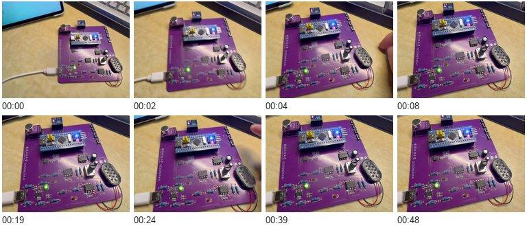
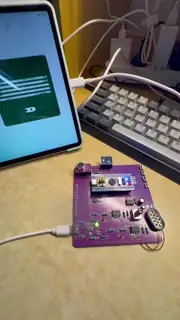
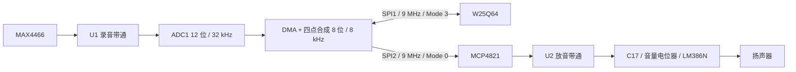
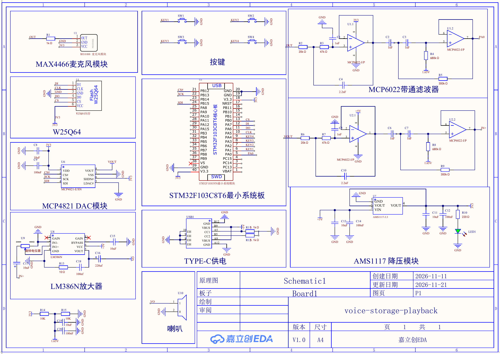

# STM32 语音存储与回放

基于 STM32F103C8T6 的板载录音与回放系统。TIM3 以 32 kHz 触发 ADC 采样，DMA 搬运采样数据。固件将每 4 个样本平均为 1 个，保存为 8 kHz、8 位 PCM，写入 W25Q64 SPI Flash。回放时固件从 Flash 读取音频，通过 MCP4821 DAC 输出。

## 实板演示



开头从桌面全景拉近到已通电的紫色 PCB。实板左上角是麦克风，中间是 Blue Pill 主控板，右侧可以看到按键、音量电位器和扬声器。约 00:04 和 00:24，手指伸向板边按键区域。后半段保持实板近景，可点击下方链接观看完整演示。

<details>
<summary>展开查看完整 49 秒无声动图（约 420 KB）</summary>



</details>

[在哔哩哔哩观看演示《数字语音存储与回放系统》](https://www.bilibili.com/video/BV157yHzjE1P/)

## 按键操作

| 按键 | 操作 |
| --- | --- |
| KEY1 | 开始或停止录音 |
| KEY2 | 暂停或继续当前录音或回放 |
| KEY3 | 开始或停止回放 |
| KEY4 | 从头播放已保存的录音 |

接通电源后，按 KEY1 开始录音，对着麦克风说话，再按 KEY1 结束并保存。按 KEY3 就能从扬声器听到录音，按 KEY4 可以从头重播。固件的 PC13 状态灯在录音或播放时点亮，暂停时熄灭，出错时快闪。

## 编译和烧录

1. 准备 Keil MDK、Arm Compiler **5.06 Update 7（build 960）**、`Keil.STM32F1xx_DFP.2.4.0` 和 ST-LINK。
2. 打开 [MDK 工程](MDK-ARM/voice-storage-playback.uvprojx)，选中 `voice-storage-playback` 目标，执行 **Project → Rebuild all target files**。输出在 `MDK-ARM/voice-storage-playback/voice-storage-playback.hex`。
3. 板子使用自己的 Type-C 供电。将 ST-LINK 的 SWDIO、SWCLK 和 GND 接到 Blue Pill 对应端子。带 VTref 的调试器接板上的 3.3 V 参考端。
4. 在 Keil 的 **Options for Target → Debug** 选择 ST-Link Debugger 和 SWD 接口。Flash 下载算法使用 STM32F103C8 的片内 Flash，地址 `0x08000000`、容量 64 KiB。执行 **Flash → Download**，下载成功后复位。
5. 按 KEY1 开始并保存录音，按 KEY3 检查回放。PC13 如出现分组短闪，查第 06 章的启动故障码。

[CubeMX 工程](voice-storage-playback.ioc)可查看引脚与外设配置。应用代码在 `App/`，初始化和主循环在 `Core/`，HAL 与 CMSIS 在 `Drivers/`。

## 制作教程

以下七章包含设计方案、器材清单、实板原理图、固件源码和调试步骤。当前固件先以 32 kHz 采样，再四点平均为 8 kHz、8 位 PCM。

1. [任务书](#tutorial-task)
2. [总体方案与器材清单](#tutorial-materials)
3. [硬件电路设计](#tutorial-circuit)
4. [实板原理图](#tutorial-schematic)
5. [软件设计与代码](#tutorial-firmware)
6. [调试与故障排查](#tutorial-debug)
7. [进阶功能](#tutorial-extensions)

<a name="tutorial-task"></a>

## 01　改编后的题目（任务书）

本章导读

- 任务与系统总体框图：录音链路、放音链路各由哪些环节组成；
- 四条基本要求、五项发挥内容与 150 分评分结构；
- 与原题在放大器、带通、ADC/DAC、存储时长上的逐项对应。

原题要求分立搭建 46dB/40dB 增益放大器、300Hz~3.4kHz 带通滤波器、8kHz/8bit ADC 与 DAC，偏重模拟电路指标。本题在**保留原题「不能使用专用语音芯片」限制**的前提下，把链路落到一套人人能搭起来的数字方案上：片内 ADC 采样、SPI Flash 存储、外扩 DAC 恢复，最终成品就是一台可以录声音、然后播放出来的数字录音机。

### 一、任务

以 STM32F103C8T6 为核心，设计并制作一个数字化语音存储与回放系统。系统框图如下：



图 1-1　系统总体框图

### 二、基本要求

**（1）录音与回放（四键操作）**

- 「录音键」开始录音，指示灯亮；再按一次或录满自动停止；
- 录音/播放过程中按「暂停键」暂停、再按继续；
- 「播放键」回放刚录的语音，再按一次停止；
- 「重播键」随时从头重放上一段录音；
- 回放语音清晰、可懂，无明显断续与爆音。

**（2）指标要求**

- 采样频率 fs = 8kHz，量化 ≥8bit（当前固件经四点合成保存为 8 位 PCM）；
- 录音通道须有带通滤波器，通带 300Hz~3.4kHz（项目采用 MCP6022 二阶低通与二阶高通级联，实板参数见第 03 章）；
- 单次录音时间 ≥ 10 秒；
- 录音、播放均有 LED 状态指示。

**（3）存储**

- 语音数据存入片外 SPI Flash（W25Q64），断电不丢失；
- 系统上电自检：能检测 Flash 型号（JEDEC ID）并报告故障。

**（4）限制**

- 不得使用 ISD18xx 等单片语音专用芯片；
- 录音/回放链路中的放大、滤波可用成品模块、运放或 RC 网络实现；

### 三、发挥部分

1. **延长录音时间**：录音时间增加至 60 秒以上（容量核算见第 2 章）；
2. **提高存储器利用率**：容量不变，采用 8bit 截取或 4bit DPCM 压缩延长录音时长；
3. **自动音量控制（AGC）**：根据输入信号强度自动调节增益，减小声音忽大忽小与削顶失真；
4. **多段录音与选段播放**：支持 ≥3 段独立录音，用按键选择播放段号；
5. 其它（例如：降低噪声电平、播放音量电位器、串口上传波形至 PC 显示等）。

### 四、评分意见

<table>
  <thead><tr><th style="width:16%">项目</th><th>内容</th><th style="width:14%">满分</th></tr></thead>
  <tbody>
    <tr><td rowspan="2">基本要求</td><td>设计与总结报告：方案论证、理论计算、电路图、测试数据与分析</td><td>50</td></tr>
    <tr><td>实际制作完成情况</td><td>50</td></tr>
    <tr><td rowspan="5">发挥部分</td><td>录音时间 ≥ 60 秒</td><td>10</td></tr>
    <tr><td>提高存储器利用率（压缩存储）</td><td>15</td></tr>
    <tr><td>自动音量控制 AGC</td><td>10</td></tr>
    <tr><td>多段录音与选段播放</td><td>10</td></tr>
    <tr><td>其它</td><td>5</td></tr>
  </tbody>
</table>

### 五、与原题的对应关系

<table>
  <thead><tr><th>原题要求</th><th>本改编方案</th><th>说明</th></tr></thead>
  <tbody>
    <tr><td>放大器 1：46dB 可调</td><td>MAX4466 模块（板载电位器调增益，25~125 倍 = <strong>28~42dB</strong>）+ 四阶带通 0dB</td><td>合计 28~42dB；模块内部已完成放大与 VCC/2 偏置，实际输入幅度需测量</td></tr>
    <tr><td>带通滤波器 300Hz~3.4kHz</td><td>录音和回放端各用一片 MCP6022 搭四阶带通，阻容值见实板 BOM</td><td>每侧为二阶滤波，成板通带需扫频确认</td></tr>
    <tr><td>ADC：8kHz / 8bit</td><td>片内 12 位 ADC，TIM3 触发 32 kHz，四点合成 8 kHz、8 位 PCM</td><td>触发与 DMA 与原题思想一致</td></tr>
    <tr><td>存储 ≥10 秒</td><td>W25Q64 8 MiB，扣除元数据扇区后容量上限约 1,048 秒</td><td>大幅超出</td></tr>
    <tr><td>DAC：8kHz / 8bit</td><td>MCP4821 12bit DAC，TIM2 定时 8kHz 恢复</td><td>8bit 数据左移 4 位送 12bit DAC</td></tr>
    <tr><td>放大器 2：40dB 可调</td><td>LM386N（默认 20 倍 = <strong>26dB</strong>；①⑧脚接 10µF 可到 200 倍 / 46dB），配 10kΩ 电位器作音量衰减</td><td>直接推动 8Ω 喇叭</td></tr>
    <tr><td>禁用专用语音芯片</td><td><mark class="key">保留该限制</mark></td><td>锻炼采样、存储、恢复的完整链路</td></tr>
  </tbody>
</table>

<a name="tutorial-materials"></a>

## 02　总体方案与器材清单

### 2.1 信号链与容量

- 录音：MAX4466 → MCP6022 带通 → PA0 / ADC1 → DMA → 四点合成 8 kHz、8 位 PCM → W25Q64。
- 回放：W25Q64 → TIM2 按 8 kHz 输出 → MCP4821 → MCP6022 带通 → 音量电位器 → LM386N → 扬声器。
- W25Q64 容量为 8 MiB，固件预留最后一个 4 KiB 扇区用于录音元数据。按每秒 8,000 字节计算，单段录音容量上限约 1,048 秒（17 分 28 秒）。实际录音时长以测试为准。
- 当前固件保存一段录音。开始新录音时会清除上一段录音的有效标记，完成写入后再保存新录音元数据。

### 2.2 实板 BOM

位号和值取自第 04 章原理图，并与 [Schematic1 网表](docs/hardware/Netlist_Schematic1_2026-11-23.tel) 核对。采购前按 EDA 封装确认脚距和安装尺寸。

| 位号 | 器件或参数 | 数量 |
| --- | --- | ---: |
| U1、U2 | MCP6022 双运放，PDIP-8 | 2 |
| U3、U4、U5 | MAX4466 麦克风模块、W25Q64 模块、STM32F103C8T6 最小系统板 | 各 1 |
| U6、U7、U8 | MCP4821，SOIC-8；AMS1117-3.3，SOT-223；LM386N，DIP-8 | 各 1 |
| U9、U10 | RV09 音量电位器、扬声器 | 各 1 |
| SW1–SW4、LED1、USB1 | 轻触开关、3 mm 电源 LED、Type-C 6P 供电座 | 4、1、1 |
| R1、R10、R13 | 1 kΩ、220 Ω、10 Ω | 各 1 |
| R2/R6、R3/R7、R4/R8、R5/R9 | 20 kΩ、47 kΩ、680 kΩ、300 kΩ | 各 2 |
| R11/R12、R14/R15 | 5.1 kΩ、10 kΩ | 各 2 |
| C1–C3、C5–C7 | 1 nF | 6 |
| C4、C10 | 2.2 nF | 2 |
| C8、C11、C13、C15、C17、C19 | 10 µF，C17 为输入耦合电解电容 | 6 |
| C9、C12、C14、C18、C20 | 100 nF | 5 |
| C16 | 220 µF 电解，扬声器输出耦合 | 1 |

### 2.3 主控引脚

| 功能 | STM32 引脚 | 实板连接或配置 |
| --- | --- | --- |
| 麦克风输入 | PA0 | U1 ⑦脚 → ADC1_IN0 |
| 四键 | PA1–PA4 | 对应 KEY1–KEY4，内部上拉，按下接地 |
| Flash SPI1 | PA5/PA6/PA7、PB0 | SCK/MISO/MOSI、软件片选，9 MHz、Mode 3 |
| DAC SPI2 | PB13/PB15、PB12 | SCK/MOSI、软件片选，9 MHz、Mode 0、16 位帧 |
| 状态灯 | PC13 | Blue Pill 板载 LED，低电平点亮 |
| SWD | PA13/PA14 | SWDIO/SWCLK；调试器与板子共地 |

<a name="tutorial-circuit"></a>

## 03　硬件电路设计

### 3.1 录音带通和偏置

MAX4466 模块用 3.3 V 供电。输出经 R1（1 kΩ）进入 U1。R2/R3 和 C1/C4 构成低通，C2/C3 和 R4/R5 构成高通。U1 ⑦脚接 PA0，R4 的参考端接 1.65 V。R14/R15 将 3.3 V 分压，C19/C20 对中点去耦。

用实际标称阻容估算，两级二阶网络的固有频率约为 3.50 kHz 和 352 Hz。此计算忽略前级源阻抗，成板的 −3 dB 通带需扫频确认。

| 二阶网络 | 实板录音 / 放音位号 | 固有频率估算 |
| --- | --- | --- |
| 低通 | R2/R3/C1/C4 和 R6/R7/C5/C10 | 1 / (2π√(20 kΩ × 47 kΩ × 1 nF × 2.2 nF)) ≈ 3.50 kHz |
| 高通 | R4/R5/C2/C3 和 R8/R9/C6/C7 | 1 / (2π√(680 kΩ × 300 kΩ × 1 nF × 1 nF)) ≈ 352 Hz |

### 3.2 存储与 DAC

W25Q64 模块用 3.3 V 供电。模块的 CLK、DO、DI 和 CS 分别接 PA5、PA6、PA7 和 PB0。固件以 256 字节为页、4 KiB 为扇区，在录音时轮询扇区擦除状态并写入 PCM。调试器可查看 `W25Q64_DebugID`。

MCP4821 的 SCK、SDI 和 CS 分别接 PB13、PB15 和 PB12，LDAC 接地。固件将 8 位 PCM 左移四位组成 12 位 DAC 数据，再与 `0x3000` 合成 16 位 SPI 帧。数字静音中点为 2048，对应理想 DAC 输出 1.024 V。

### 3.3 放音带通与功放

MCP4821 输出经 R6/R7、C5/C10、C6/C7 和 R8/R9 组成的 U2 带通。U2 用 5 V 供电，R8 接 1.65 V 偏置。U2 ⑦脚经 C17 隔直送到 U9，电位器滑动端接 LM386N ③脚。

LM386N 的 ①⑧脚悬空，C15 接旁路脚。⑤脚输出经 C16（220 µF）耦合到扬声器，R13/C18 组成输出端 Zobel 网络。

### 3.4 电源与指示

Type-C VBUS 给 U2、LM386N 和 AMS1117-3.3 输入供电。CC1/CC2 各经 R11/R12（5.1 kΩ）下拉。稳压后的 3.3 V 给 Blue Pill、MAX4466、W25Q64、MCP4821 和 U1 供电。实板的 Blue Pill 5 V 引脚悬空，外部 3.3 V 接最小系统板的 3.3 V 端。LED1 由 3.3 V 经 R10 点亮，PC13 板载灯显示录放状态。

<a name="tutorial-schematic"></a>

## 04　实板原理图

实板的元件位号、参数和连线以原理图为准。

[](https://raw.githubusercontent.com/kaiture/voice-storage-playback/main/docs/SCH_Schematic1_2026-11-24.png)

[下载原理图 PDF](https://raw.githubusercontent.com/kaiture/voice-storage-playback/main/docs/SCH_Schematic1_2026-11-24.pdf)

### 可编辑工程和制板文件

可编辑文件和 Gerber 来自 2026-11-21 的立创 EDA 项目备份。原理图和 PCB 文件均可在立创 EDA 专业版通过 **导入专业版** 打开。需要放在同一工程时，先导入原理图，再将 PCB 导入该工程。

- [Schematic1 可编辑原理图](docs/hardware/voice-storage-playback-Schematic1.epro2)
- [PCB1 可编辑 PCB](docs/hardware/voice-storage-playback-PCB1.epro2)
- [PCB1 Gerber 和钻孔文件](docs/hardware/voice-storage-playback-PCB1-Gerber.zip)
- [Schematic1 网表](docs/hardware/Netlist_Schematic1_2026-11-23.tel)

导出检查使用立创 EDA 专业版 4.1.105。原理图检查报告 13 项警告，PCB1 DRC 报告 39 项间距违规。Gerber 为保存原版布局的复核资料，打板前请按实际板厂规则复查。

<a name="tutorial-firmware"></a>

## 05　软件设计与源码

### 5.1 时钟和外设配置

[CubeMX 工程](voice-storage-playback.ioc)使用 STM32CubeMX 6.19.0。以下配置与提交的固件一致。

| 外设 | 当前配置 |
| --- | --- |
| RCC | HSE 8 MHz ×9 得到 SYSCLK 72 MHz，APB1 36 MHz，TIM2/TIM3 输入时钟 72 MHz |
| ADC1 | PA0 / IN0，12 位右对齐，采样时间 55.5 周期，由 TIM3 TRGO 触发 |
| DMA1 Channel 1 | 16 位传输，循环模式，高优先级，半满与全满回调 |
| TIM3 | PSC=0，ARR=2249，更新频率 32 kHz，用于 ADC 触发 |
| TIM2 | PSC=0，ARR=8999，更新中断为 8 kHz，用于 DAC 回放 |
| SPI1 | W25Q64，8 位，72 MHz ÷8 = 9 MHz，Mode 3（CPOL=1、CPHA=1） |
| SPI2 | MCP4821，16 位，36 MHz ÷4 = 9 MHz，Mode 0（CPOL=0、CPHA=0） |
| GPIO | PB0/PB12 为软件片选，PA1–PA4 为上拉输入，PC13 为低有效状态灯 |

### 5.2 Flash 驱动

[`w25q64.c`](App/Src/w25q64.c)读取 JEDEC ID 的类型字节和容量字节。常见 Winbond W25Q64 的 ID 为 `0xEF4017`。驱动也允许类型字节为 `0x40` 的兼容芯片，实际读数可从调试变量 `W25Q64_DebugID` 查看。最后一个扇区保留给录音元数据，其余扇区保存 PCM。

### 5.3 DAC 驱动

[`mcp4821.c`](App/Src/mcp4821.c)将 12 位 DAC 数据和 `0x3000` 组合为 16 位命令。PB12 拉低时发送一个 SPI2 帧，然后拉高片选。暂停或停止回放时，固件会将 DAC 输出恢复到数字静音中点。

### 5.4 录音与量化

[`record.c`](App/Src/record.c)在开始录音时先擦除上一段录音的元数据，再启用 ADC DMA 和 TIM3。每次 DMA 半满或全满回调处理 1,024 个原始采样，得到 256 字节 PCM 块。四个 12 位样本求和后量化，核心计算如下。

```c
uint32_t code = (sum + 8U) >> 6U;
record_queue[head][i] = (uint8_t)((code > 255U) ? 255U : code);
```

主循环轮询扇区擦除，并从队列取数据写入 Flash。录满 Flash 或再次按 KEY1 时结束录音，先写完待处理音频，再提交元数据。正常保存后的录音可在下次上电读回。

### 5.5 回放双缓冲

[`play.c`](App/Src/play.c)将连续 512 字节缓冲区分成两个 256 字节半区。TIM2 每 125 µs 向 DAC 送一个样本，主循环从 Flash 补充刚释放的半区。半区未及时填充或 SPI 失败时，回放进入错误处理。每半区对应 32 ms 音频。

### 5.6 按键与状态机

[`key.c`](App/Src/key.c)每 10 ms 扫描一次，连续三次读到新状态后确认变化。[`main.c`](Core/Src/main.c)处理录音、录音暂停、回放、回放暂停、空闲与出错。KEY4 在空闲、有录音时可开始播放，或在播放及播放暂停时从头重播。[`led.c`](App/Src/led.c)控制 PC13 的常亮、熄灭与错误闪烁。

常用状态转换如下。录音或回放完成后回到空闲，读取、写入或采样失败时进入错误状态。

| 当前状态 | KEY1 | KEY2 | KEY3 | KEY4 |
| --- | --- | --- | --- | --- |
| 空闲或出错 | 开始新录音 | — | 有录音时播放 | 有录音时从头播放 |
| 录音 / 录音暂停 | 结束并保存 | 切换录音与暂停 | — | — |
| 回放 / 回放暂停 | — | 切换回放与暂停 | 停止回放 | 从头重播 |

<a name="tutorial-debug"></a>

## 06　调试和验证记录

### 6.1 上电和信号检查

1. 上电前核对 5 V、3.3 V 与 GND，确认 Blue Pill 的 5 V 排针未接到外部 5 V。
2. 上电后检查 3.3 V 和 1.65 V 偏置，再检查两个带通输出的直流工作点（U1/U2 的 ⑦脚）。
3. 用调试器读取 `W25Q64_DebugID`。上电故障停在闪灯状态时，按短闪次数排查。
4. 录音时可用 SWD 观察 ADC DMA 缓冲，确认说话时波形有变化，峰值没有贴近 0 或 4095。
5. 按 KEY1 开始并结束录音，再用 KEY3 回放。用 KEY2 验证暂停和继续，用 KEY4 验证从头重播。正常结束录音后重新上电，再确认能读回保存内容。

### 6.2 PC13 上电故障码

| 短闪次数 | 排查方向 |
| ---: | --- |
| 1 | DAC 初始化失败，核对 SPI2、片选与供电 |
| 2 | Flash ID 为 `0xFFFFFF`，核对片选、MISO 与供电 |
| 3 | 读取失败或 Flash ID 为零，核对 MISO 电平与接线 |
| 4 | Flash 返回了其他 ID，读取 `W25Q64_DebugID` 核对类型及容量 |
| 5 | 录音子系统初始化失败，检查 Flash 元数据读取和 ADC 校准 |
| 6 | 回放子系统初始化失败，检查 DAC 输出初始化 |

### 6.3 验证记录和测量方法

| 检查项 | 结果、配置或目标 | 验证方法 |
| --- | --- | --- |
| 固件重建 | Keil ARMCC 5.06 Update 7，0 错误、0 警告，生成 HEX | 从仓库的干净源码 Rebuild |
| 录放演示 | 实板演示已发布 | 见 README 顶部视频 |
| ADC 硬件触发 | 配置值 32 kHz，周期 31.25 µs | TIM3 TRGO 是内部信号，实测时用诊断固件将定时器节拍引到可测引脚 |
| PCM 和 DAC 回放 | 配置值 8 kHz，周期 125 µs | 固定时间内核对 PCM 样本数，或录制逻辑分析仪轨迹核对 DAC 帧间隔 |
| 实际录音时长和断电保留 | 待测 | 记录音频长度和秒表时间，正常停止录音后断电再播放 |
| 滤波频响、底噪和回放可懂度 | 待测 | 扫频记录 −3 dB 点，静音采集 RMS，按固定音量进行盲听 |
| 电源和模拟偏置 | 3.3 V 电源轨、1.65 V 中点为设计值 | 用万用表记录实板电压 |

<a name="tutorial-extensions"></a>

## 07　可扩展功能

当前仓库的可运行功能为单段录音、暂停、回放与重播。自动增益、压缩和多段选播是可扩展方向。

- **AGC**可在录音写入前根据块信号强度平滑调整数字增益，并限制过载时的峰值。
- **压缩**可尝试 4 位 ADPCM，并用相同录音比较占用空间和回放效果。
- **多段录音**可增加片段目录与容量分配，定义断电恢复规则后再加入选段界面。

## 参考资料

- [1999 年全国大学生电子设计竞赛 E 题原文](https://nuedc.org/problems/1999_E%E9%A2%98_%E6%95%B0%E5%AD%97%E5%8C%96%E8%AF%AD%E9%9F%B3%E5%AD%98%E5%82%A8%E4%B8%8E%E5%9B%9E%E6%94%BE%E7%B3%BB%E7%BB%9F.pdf)
- [ST STM32F103C8 数据手册](https://www.st.com/resource/en/datasheet/stm32f103c8.pdf)
- [ST RM0008 参考手册](https://www.st.com/resource/en/reference_manual/rm0008-stm32f101xx-stm32f102xx-stm32f103xx-stm32f105xx-and-stm32f107xx-advanced-armbased-32bit-mcus-stmicroelectronics.pdf)
- [Winbond W25Q64JV 产品资料](https://www.winbond.com/hq/product/code-storage-flash/qspi-nor/w25q-jv/?__locale=en&partNo=W25Q64JVSSIQ)
- [Microchip MCP4821](https://www.microchip.com/en-us/product/MCP4821) · [Microchip MCP6022](https://www.microchip.com/en-us/product/MCP6022)
- [TI LM386](https://www.ti.com/product/LM386) · [ADI MAX4466](https://www.analog.com/en/products/max4466.html)

## 许可

项目自有内容的许可由维护者确认。第三方驱动使用各自的许可文件。
[CMSIS](Drivers/CMSIS/LICENSE.txt) · [STM32F1 CMSIS Device](Drivers/CMSIS/Device/ST/STM32F1xx/LICENSE.txt) · [STM32F1 HAL](Drivers/STM32F1xx_HAL_Driver/LICENSE.txt)
