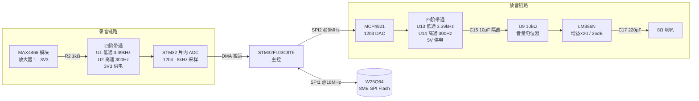
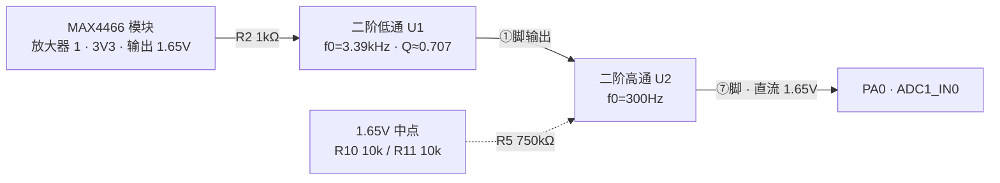
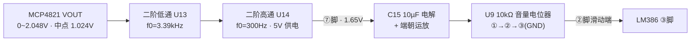
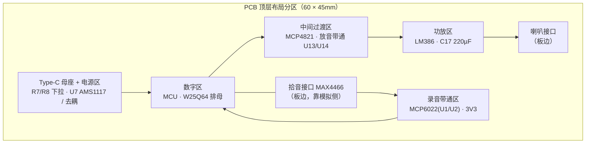
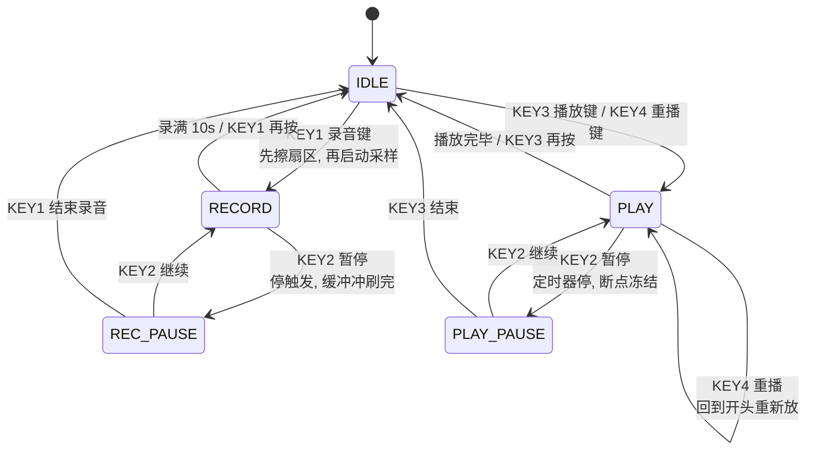

# STM32 语音存储与回放

基于 STM32F103C8T6 的板载录音与回放系统。TIM3 以 32 kHz 触发 ADC 采样，DMA 搬运采样数据。固件将每 4 个样本平均为 1 个，保存为 8 kHz、8 位 PCM，写入 W25Q64 SPI Flash。回放时固件从 Flash 读取音频，通过 MCP4821 DAC 输出。

## 实板演示


开头从桌面全景拉近到已通电的紫色 PCB。实板左上角是麦克风，中间是 Blue Pill 主控板，右侧可以看到按键、音量电位器和扬声器。约 00:04 和 00:24，手指伸向板边按键区域。后半段保持实板近景，可结合下方轻量版的现场音轨查看完整演示。

<details>
<summary>展开查看完整 49 秒无声动图（约 420 KB）</summary>


</details>

[播放带原声的轻量版演示（49 秒，约 637 KB）](https://raw.githubusercontent.com/kaiture/voice-storage-playback/main/docs/demo-small.mp4)

## 按键操作

| 按键 | 操作 |
| --- | --- |
| KEY1 | 开始或停止录音 |
| KEY2 | 暂停或继续当前录音或回放 |
| KEY3 | 开始或停止回放 |
| KEY4 | 从头播放已保存的录音 |

接通电源后，按 KEY1 开始录音，对着麦克风说话，再按 KEY1 结束并保存。按 KEY3 就能从扬声器听到录音，按 KEY4 可以从头重播。固件的 PC13 状态灯在录音或播放时点亮，暂停时熄灭，出错时快闪。

## 编译

使用 Keil MDK 打开 [MDK 工程](MDK-ARM/voice-storage-playback.uvprojx)，选择 `voice-storage-playback` 目标并编译。工程配置使用 Arm Compiler 5.06 和 STM32F1 设备支持包。[CubeMX 配置](voice-storage-playback.ioc)可用于查看引脚与外设设置。

应用代码位于 `App/`，STM32 初始化和主循环位于 `Core/`，HAL 与 CMSIS 位于 `Drivers/`。

## 制作教程

以下八章包含设计方案、器材清单、接线表、固件示例和调试步骤。示例代码用于解释设计，烧录使用仓库中的 Keil 工程。当前固件先以 32 kHz 采样，再四点平均为 8 kHz、8 位 PCM。

1. [任务书](#tutorial-task)
2. [总体方案与器材清单](#tutorial-materials)
3. [硬件电路设计](#tutorial-circuit)
4. [原理图绘制](#tutorial-schematic)
5. [PCB 布线](#tutorial-pcb)
6. [软件设计与代码](#tutorial-firmware)
7. [调试与故障排查](#tutorial-debug)
8. [进阶功能](#tutorial-extensions)

<a name="tutorial-task"></a>

## 01　改编后的题目（任务书）

本章导读

- 任务与系统总体框图：录音链路、放音链路各由哪些环节组成；
- 四条基本要求、五项发挥内容与 150 分评分结构；
- 与原题在放大器、带通、ADC/DAC、存储时长上的逐项对应。

原题要求分立搭建 46dB/40dB 增益放大器、300Hz~3.4kHz 带通滤波器、8kHz/8bit ADC 与 DAC，偏重模拟电路指标。本题在**保留原题「不能使用专用语音芯片」限制**的前提下，把链路落到一套人人能搭起来的数字方案上：片内 ADC 采样、SPI Flash 存储、外扩 DAC 恢复，最终成品就是一台可以录声音、然后播放出来的数字录音机。

### 一、任务

以 STM32F103C8T6 为核心，设计并制作一个数字化语音存储与回放系统。系统框图如下：



图 1-1　系统总体框图

### 二、基本要求

**（1）录音与回放（四键操作）**

- 「录音键」开始录音，指示灯亮；再按一次或录满自动停止；
- 录音/播放过程中按「暂停键」暂停、再按继续；
- 「播放键」回放刚录的语音，再按一次停止；
- 「重播键」随时从头重放上一段录音；
- 回放语音清晰、可懂，无明显断续与爆音。

**（2）指标要求**

- 采样频率 fs = 8kHz，量化 ≥8bit（本题用 12bit ADC，取高 8 位兼容原题）；
- 录音通道须有带通滤波器，通带 300Hz~3.4kHz（本方案用 MCP6022 搭四阶巴特沃兹带通：二阶低通 + 二阶高通级联，见 3.1）；
- 单次录音时间 ≥ 10 秒；
- 录音、播放均有 LED 状态指示。

**（3）存储**

- 语音数据存入片外 SPI Flash（W25Q64），断电不丢失；
- 系统上电自检：能检测 Flash 型号（JEDEC ID）并报告故障。

**（4）限制**

- 不得使用 ISD18xx 等单片语音专用芯片；
- 录音/回放链路中的放大、滤波可用成品模块、运放或 RC 网络实现；

### 三、发挥部分

1. **延长录音时间**：录音时间增加至 60 秒以上（容量核算见第 2 章）；
2. **提高存储器利用率**：容量不变，采用 8bit 截取或 4bit DPCM 压缩延长录音时长；
3. **自动音量控制（AGC）**：根据输入信号强度自动调节增益，减小声音忽大忽小与削顶失真；
4. **多段录音与选段播放**：支持 ≥3 段独立录音，用按键选择播放段号；
5. 其它（例如：降低噪声电平、播放音量电位器、串口上传波形至 PC 显示等）。

### 四、评分意见

<table>
  <thead><tr><th style="width:16%">项目</th><th>内容</th><th style="width:14%">满分</th></tr></thead>
  <tbody>
    <tr><td rowspan="2">基本要求</td><td>设计与总结报告：方案论证、理论计算、电路图、测试数据与分析</td><td>50</td></tr>
    <tr><td>实际制作完成情况</td><td>50</td></tr>
    <tr><td rowspan="5">发挥部分</td><td>录音时间 ≥ 60 秒</td><td>10</td></tr>
    <tr><td>提高存储器利用率（压缩存储）</td><td>15</td></tr>
    <tr><td>自动音量控制 AGC</td><td>10</td></tr>
    <tr><td>多段录音与选段播放</td><td>10</td></tr>
    <tr><td>其它</td><td>5</td></tr>
  </tbody>
</table>

### 五、与原题的对应关系

<table>
  <thead><tr><th>原题要求</th><th>本改编方案</th><th>说明</th></tr></thead>
  <tbody>
    <tr><td>放大器 1：46dB 可调</td><td>MAX4466 模块（板载电位器调增益，25~125 倍 = <strong>28~42dB</strong>）+ 四阶带通 0dB</td><td>合计 28~42dB；模块内部已完成放大与 VCC/2 偏置，8bit 存储下实测足够</td></tr>
    <tr><td>带通滤波器 300Hz~3.4kHz</td><td>录音端：MCP6022 搭<strong>四阶巴特沃兹带通（低通 3.39kHz + 高通 300Hz）</strong>；放音端：另一片 MCP6022 搭同参数四阶带通</td><td>每路为完整带通，通带外每侧 12dB/倍频程滚降</td></tr>
    <tr><td>ADC：8kHz / 8bit</td><td>片内 12bit ADC，TIM3 触发 8kHz，软件取高 8bit</td><td>触发与 DMA 与原题思想一致</td></tr>
    <tr><td>存储 ≥10 秒</td><td>W25Q64 8MB，8bit@8kHz 理论可录 ≈1024 秒</td><td>大幅超出</td></tr>
    <tr><td>DAC：8kHz / 8bit</td><td>MCP4821 12bit DAC，TIM2 定时 8kHz 恢复</td><td>8bit 数据左移 4 位送 12bit DAC</td></tr>
    <tr><td>放大器 2：40dB 可调</td><td>LM386N（默认 20 倍 = <strong>26dB</strong>；①⑧脚接 10µF 可到 200 倍 / 46dB），配 10kΩ 电位器作音量衰减</td><td>直接推动 8Ω 喇叭</td></tr>
    <tr><td>禁用专用语音芯片</td><td><mark class="key">保留该限制</mark></td><td>锻炼采样、存储、恢复的完整链路</td></tr>
  </tbody>
</table>

<a name="tutorial-materials"></a>

## 02　总体方案与器材清单

本章导读

- 从 8kHz × 1Byte = 8KB/s 的数据速率反推容量与录音时长；
- 用一条 dB 账确认「不需要第三级放大器」，并给出增益分配表；
- BOM 与 Blue Pill 40P 排针序号一次对齐，照表接线即可。

### 2.1 信号链与数据速率

录音链路为 **MAX4466（放大器 1）→ R2 1kΩ → MCP6022 四阶带通 300Hz~3.4kHz → PA0**；带通本身就把 4kHz 以上压住，因此不再另设 RC 抗混叠网络。放音链路为 **MCP4821 → MCP6022 四阶带通 300Hz~3.4kHz → C15 隔直 → 10kΩ 音量电位器 → LM386N → 喇叭**。

语音信号带宽取 300Hz~3.4kHz（电话质量），按奈奎斯特定理取采样率 fs = 8kHz（> 2×3.4kHz）。ADC 12bit 采样后取**高 8 位**存储，数据速率：

**8kHz × 1Byte = 8KB/s**

W25Q64 总容量 8MB = 8 388 608 Byte，理论可录 ≈1024 秒。即使按原题 16bit 存储也有 512 秒，远超「≥10 秒」的要求。

图 2-1　不同存储位宽下 W25Q64（8MB）的可用录音时长

12 位按 2 字节存储约 512 秒，8 位 PCM 约 1024 秒，4 位 DPCM 约 2048 秒（教程估算）。

写入速度校验：Flash 页编程（256Byte）典型 0.7ms、最大 3ms，而 256Byte 语音数据每 32ms 才产生一次，写入完全来得及，只需注意「先擦后录」（见 6.4 节）。

#### 增益还够不够：一条链走的 dB 账

题目要「放大器 1 增益 46dB 可调、放大器 2 增益 40dB 可调」。dB 与倍数的换算是**电压比 20lg**：

**dB = 20 · lg(倍数)**　（46dB ≈ 200 倍，40dB = 100 倍）

注意别用 10lg（那是功率比），否则会把 42dB 算成 158 倍，越算越乱。整条链的增益分配如下：

<table>
  <thead><tr><th>环节</th><th>倍数</th><th>dB</th><th>说明</th></tr></thead>
  <tbody>
    <tr><td>MAX4466（放大器 1）</td><td>25~125</td><td>28~42</td><td>板载电位器，正常说话峰值占 ADC 满量程 70%~90% 即可</td></tr>
    <tr><td>录音四阶带通（U1/U2）</td><td>1</td><td>0</td><td>两级 Sallen-Key 都接成跟随器，只滤波不放大</td></tr>
    <tr><td><strong>录音端合计</strong></td><td><strong>25~125</strong></td><td><strong>28~42</strong></td><td>8bit 存储对 42dB 已足够；原题 46dB 是上限指标，实测正常说话可占满 ADC 的 70%~90%</td></tr>
    <tr><td>MCP4821 输出</td><td>1</td><td>0</td><td>满幅 0~2.048V，中点 1.024V</td></tr>
    <tr><td>放音四阶带通（U13/U14）</td><td>1</td><td>0</td><td>跟随器，通带内 0dB；中心频率 1.01kHz、带宽 3.1kHz</td></tr>
    <tr><td>10kΩ 音量电位器</td><td>0~1</td><td>0 ~ −∞</td><td>信号侧衰减，调到最小即静音</td></tr>
    <tr><td>LM386（放大器 2）</td><td>20 / 50 / 200</td><td>26 / 34 / 46</td><td>默认 ①⑧悬空 = 20 倍（见 3.5）</td></tr>
    <tr><td><strong>放音端合计</strong></td><td><strong>20~200（可衰减）</strong></td><td><strong>26~46 可调</strong></td><td>默认 26dB；需要更大音量时按 3.5 表改 ①⑧接法</td></tr>
  </tbody>
</table>

结论：**不需要再加第三级放大器**。录音端靠 MAX4466 模块的电位器（28~42dB），放音端靠 LM386 的 ①⑧脚配置（默认 26dB，最高 46dB）+ 电位器衰减，两端都能落在题目要求的档位附近。若实测录音偏轻，优先把 MAX4466 电位器拧大，而不是改带通电阻——四阶带通的电阻同时决定截止频率与 Q 值，动了会让通带形状变形。

### 2.2 器材清单（BOM）

<table>
  <thead><tr><th>模块</th><th>器件</th><th>数量</th><th>备注</th></tr></thead>
  <tbody>
    <tr><td>主控</td><td>STM32F103C8T6 最小系统板（Blue Pill）</td><td>1</td><td>72MHz，12bit ADC，2 路 SPI</td></tr>
    <tr><td>拾音</td><td>MAX4466 驻极体麦克风放大模块</td><td>1</td><td>板载电位器调增益，输出偏置 VCC/2</td></tr>
    <tr><td>存储</td><td>W25Q64 模块（或 SOP8 转接）</td><td>1</td><td>8MB SPI Flash</td></tr>
    <tr><td>DAC</td><td>MCP4821（DIP-8）</td><td>1</td><td>12bit SPI DAC，内置 2.048V 基准</td></tr>
    <tr><td>录音带通</td><td>MCP6022（DIP-8，双运放）1 片 + 23.2kΩ、43.2kΩ、374kΩ、750kΩ 各 1 只，1nF×3、2.2nF×1，R2 1kΩ</td><td>1 套</td><td>四阶巴特沃兹带通：二阶低通 3.39kHz + 二阶高通 300Hz；<strong>3.3V 供电</strong>，输出直流 1.65V（见 3.1）</td></tr>
    <tr><td>放音带通</td><td>MCP6022（DIP-8，双运放）1 片 + 与录音带通完全相同的阻容（23.2kΩ、43.2kΩ、374kΩ、750kΩ、1nF×3、2.2nF×1）</td><td>1 套</td><td>同参数四阶带通，<strong>5V 供电</strong>；输出经 C15 10µF 隔直送电位器（见 3.4）</td></tr>
    <tr><td>偏置/音量</td><td>10kΩ×2（1.65V 分压）、C13/C16 100nF×2、C15 10µF 电解、U9 10kΩ 电位器</td><td>1 套</td><td>1.65V 中点供两路带通的 750kΩ 下端；C15 隔直后接音量电位器</td></tr>
    <tr><td>功放</td><td>LM386N-1（DIP-8）+ C17 220µF 电解 + C14 100nF + R9 10Ω + C12 100nF</td><td>1</td><td>①⑧悬空 = 20 倍 / 26dB；C17 220µF 耦合喇叭（+ 端朝 LM386），C14 100nF + R9 10Ω 作 Zobel，C12 100nF 接 ⑦脚</td></tr>
    <tr><td>喇叭</td><td>8Ω 0.5W 小喇叭（或 32Ω 耳机）</td><td>1</td><td></td></tr>
    <tr><td>人机交互</td><td>轻触按键 ×4、LED ×2（各串 1kΩ）</td><td>—</td><td>录音 / 暂停 / 播放 / 重播，录音 / 播放指示</td></tr>
    <tr><td>电源</td><td>USB 充电宝（5V 输出）+ Type-C 数据线</td><td>1</td><td>全系统单 5V 供电（见 3.6）；建议选无「小电流自动关机」功能的充电宝</td></tr>
    <tr><td>供电接口</td><td>Type-C 母座（6P 供电型即可，如 TYPE-C-31-M-12）+ R7/R8 5.1kΩ ×2</td><td>1</td><td><strong>CC1（A5）、CC2（B5）必须各接 5.1kΩ 下拉到 GND</strong>，否则多数充电宝/充电器不输出 5V（见 3.6）</td></tr>
    <tr><td>稳压</td><td>AMS1117-3.3（U7，SOT-223）+ 10µF×2 + 0.1µF</td><td>1</td><td>5V → 3.3V，供 Blue Pill、W25Q64、MAX4466、MCP4821、录音带通 U1/U2</td></tr>
    <tr><td>电源指示</td><td>R6 220Ω + LED1</td><td>1</td><td>5V 经 220Ω 点亮，上电即知电源是否到位</td></tr>
    <tr><td>其它</td><td>面包板/洞洞板、杜邦线、10µF/0.1µF 退耦电容若干</td><td>—</td><td></td></tr>
  </tbody>
</table>

### 2.3 引脚分配总表（Blue Pill 模块，按排针序号）

本方案直接用 **STM32F103C8T6 最小系统板（Blue Pill）**，板上已带 8MHz 晶振、复位电路和 AMS1117-3.3，因此只需要按 40P 排针序号接线。**下表序号是 Blue Pill 排针脚号，不是 LQFP48 芯片脚号**，照着模块丝印数即可。

**① 信号引脚（软件使用的 GPIO / 外设）**

<table>
  <thead><tr><th>功能组</th><th>MCU 引脚（排针序号）</th><th>方向</th><th>工作模式</th><th>连接对象</th><th>说明</th></tr></thead>
  <tbody>
    <tr><td>模拟输入</td><td>PA0（5）</td><td>输入</td><td>ADC1_IN0 模拟</td><td>录音四阶带通输出 U2 ⑦脚</td><td>8kHz 定时触发采样，12bit 右对齐；带通 300Hz~3.4kHz 兼作抗混叠</td></tr>
    <tr><td rowspan="4">按键</td><td>PA1（6）</td><td>输入</td><td>GPIO 输入上拉</td><td>KEY1 → GND</td><td>录音键：开始录音 / 再按结束，软件消抖 20ms</td></tr>
    <tr><td>PA2（7）</td><td>输入</td><td>GPIO 输入上拉</td><td>KEY2 → GND</td><td>暂停键：录音、播放过程中暂停 / 继续</td></tr>
    <tr><td>PA3（8）</td><td>输入</td><td>GPIO 输入上拉</td><td>KEY3 → GND</td><td>播放键：回放刚录内容 / 再按停止</td></tr>
    <tr><td>PA4（9）</td><td>输入</td><td>GPIO 输入上拉</td><td>KEY4 → GND</td><td>重播键：任意时刻从头重放上一段录音</td></tr>
    <tr><td rowspan="2">指示灯</td><td>PC13（板载）</td><td>输出</td><td>GPIO 推挽</td><td>板载 LED（负极接 PC13）</td><td>录音指示，<strong>低电平点亮</strong>（Blue Pill 板载灯反接）</td></tr>
    <tr><td>PB1（14）</td><td>输出</td><td>GPIO 推挽</td><td>1kΩ → LED → GND</td><td>播放指示，高电平点亮</td></tr>
    <tr><td rowspan="4">SPI1<br>→ W25Q64</td><td>PA5（10）</td><td>输出</td><td>SPI1_SCK 复用推挽</td><td>W25Q64 ②脚 CLK</td><td>APB2 72MHz ÷ 4 = <strong>18MHz</strong>，模式 0</td></tr>
    <tr><td>PA6（11）</td><td>输入</td><td>SPI1_MISO 复用</td><td>W25Q64 ④脚 DO</td><td>主机读数据</td></tr>
    <tr><td>PA7（12）</td><td>输出</td><td>SPI1_MOSI 复用推挽</td><td>W25Q64 ①脚 DI</td><td>主机写数据</td></tr>
    <tr><td>PB0（13）</td><td>输出</td><td>GPIO 推挽</td><td>W25Q64 ⑤脚 /CS，10kΩ 上拉 3.3V</td><td>Flash 片选，<strong>软件控制</strong>（不用硬件 NSS）</td></tr>
    <tr><td rowspan="3">SPI2<br>→ MCP4821</td><td>PB13（22）</td><td>输出</td><td>SPI2_SCK 复用推挽</td><td>MCP4821 ③脚 SCK</td><td>APB1 36MHz ÷ 4 = <strong>9MHz</strong>，模式 0，<strong>16bit 帧</strong></td></tr>
    <tr><td>PB15（24）</td><td>输出</td><td>SPI2_MOSI 复用推挽</td><td>MCP4821 ④脚 SDI</td><td>DAC 与 Flash 分用两路 SPI，避免总线冲突；PB14 不用，悬空</td></tr>
    <tr><td>PB12（21）</td><td>输出</td><td>GPIO 推挽</td><td>MCP4821 ②脚 /CS，10kΩ 上拉 3.3V</td><td>DAC 片选，CS 上升沿更新输出；⑤脚 /LDAC 直接接地</td></tr>
    <tr><td rowspan="3">调试/扩展</td><td>PA13（SWDIO）</td><td>双向</td><td>SWDIO</td><td>板上 4P SWD 排针</td><td>下载与在线调试，必接</td></tr>
    <tr><td>PA14（SWCLK）</td><td>双向</td><td>SWCLK</td><td>板上 4P SWD 排针</td><td>必接</td></tr>
    <tr><td>PA9（30）</td><td>输出</td><td>USART1_TX 复用推挽</td><td>USB-TTL 模块 RX</td><td>可选调试串口 230400bps：打印日志 / 上传波形画图（见 8.4）</td></tr>
  </tbody>
</table>

**② 电源与地（Blue Pill 排针）**

<table>
  <thead><tr><th>排针（序号）</th><th>接法</th><th>说明</th></tr></thead>
  <tbody>
    <tr><td>5V（38）</td><td>Type-C VBUS（+5V）</td><td>给 LM386、放音带通 U13/U14 供电；也可作为板载稳压输入</td></tr>
    <tr><td>3V3（18 / 40）</td><td>3.3V 电源轨</td><td>供 W25Q64、MAX4466、MCP4821、录音带通 U1/U2；<strong>与外部 U7 输出二选一，切勿并联</strong></td></tr>
    <tr><td>GND（19 / 20 / 39）</td><td>公共地</td><td>所有模块与模拟地单点汇合到 Type-C 入口</td></tr>
    <tr><td>NRST（17）</td><td>可接复位按键</td><td>板上已有 10kΩ 上拉与 0.1µF，不接也能工作</td></tr>
    <tr><td>BOOT0 / BOOT1</td><td>板上跳线保持默认（BOOT0=0）</td><td>正常从 Flash 启动，不需要额外接线</td></tr>
  </tbody>
</table>

**引脚分配的三点设计考虑**

1. **ADC 输入选 PA0~PA7**：F103 的 12bit ADC1 只挂在 APB2 的 PA 口，选 PA0 直接对应通道 IN0，避免重映射麻烦；
2. **DAC 单独用 SPI2**（PB13/PB15）：播放时 8kHz 中断发 DAC 帧与主循环读 Flash 若共总线会冲突，分成两路后互不干扰，代码简单得多——这是本题最值得吸取的工程经验；
3. **按键/LED 都挑了富余的简单 IO**：避开 SWD 与串口，PB0/PB12 分别做 Flash、DAC 片选；剩余 PB10/PB11、PB8/PB9 等建议引到一排 4P 排针备用（发挥部分扩展用）。


<a name="tutorial-circuit"></a>

## 03　硬件电路设计

本章导读

- 录音通道：MAX4466 → U1 低通 3.39kHz → U2 高通 300Hz → PA0；
- 放音通道：MCP4821 → U13/U14 四阶带通 → C15 → 10kΩ 电位器 → LM386；
- 四个必须记住的细节：750kΩ 接 1.65V、U1/U2 用 3V3、U13/U14 用 5V、Type-C 的 CC 下拉。

### 3.1 录音通道：MAX4466 → 四阶带通（U1/U2）→ ADC

原题框图的录音链路是「拾音器 → 放大器 1 → 带通滤波器 → ADC」。对应到本方案：**MAX4466 模块**承担放大器 1（增益 25~125 倍，输出偏置 1.65V），后面用 **MCP6022 的两个运放单元**搭四阶巴特沃兹带通：低通级（U1）做 3.39kHz 二阶低通，高通级（U2）做 300Hz 二阶高通，级联后通带 300Hz~3.4kHz，再经 R2 送 PA0。



图 3-1　录音四阶带通：二阶低通 + 二阶高通级联，两节都接成单位增益跟随器

**为什么用四阶、为什么两级都接成跟随器。**二阶带通的滚降只有 ±6dB/倍频程，300Hz 以下的手持噪声和 4kHz 以上的齿音压不干净；四阶（低通、高通各二阶）把两侧滚降提高到 ±12dB/倍频程。两级都接成**单位增益跟随器**（①=②、⑥=⑦），带通整体增益 0dB，增益全部交给 MAX4466 的电位器——这样滤波器的 Q 值只由阻容决定，调音量不会改变通带形状。

#### 电路一：二阶低通（U1，3.39kHz）

```text
R2 1kΩ ──[R3 23.2kΩ]──●──[R4 43.2kΩ]──●──── ③脚 (+IN A)
                      │               │
                  [C5 2.2nF]       [C2 1nF]
                      │               │
                 ①脚 (OUT A)         GND
                      │
                      └── ②脚 (IN−A)   ← ①=② 跟随器，单位增益

f0 = 1/(2π√(R3·R4·C2·C5)) ≈ 3.39kHz
Q  = √(R3·R4·C2·C5) / [C2·(R3+R4)] ≈ 0.707
```

#### 电路二：二阶高通（U2，300Hz）

```text
①脚 (OUT A) ──[C3 1nF]──●──[C4 1nF]──●──── ⑤脚 (+IN B)
                         │              │
                     [R1 374kΩ]     [R5 750kΩ]
                         │              │
                    ⑦脚 (OUT B)      1.65V 中点
                         │
                         └── ⑥脚 (IN−B)   ← ⑥=⑦ 跟随器，单位增益

f0 = 1/(2π√(R1·R5·C3·C4)) ≈ 300Hz
```

#### 1.65V 中点（两路带通共用）

```text
3V3 ──[R10 10kΩ]──●──[R11 10kΩ]── GND
                  │
             [C13 100nF] ∥ [C16 100nF]
                  │
                 GND
```

R10/R11 把 3.3V 分成 1.65V，C13/C16 滤掉电源噪声。**这个 1.65V 不是装饰，它是高通级 750kΩ 电阻唯一的交流参考点**：R5 下端必须接这里，不能接地。

#### 元件值与频率校验

<table>
  <thead><tr><th>位号</th><th>值</th><th>作用</th><th>计算</th></tr></thead>
  <tbody>
    <tr><td>R3（R15）</td><td>23.2kΩ</td><td>低通第一节电阻</td><td rowspan="4">f<sub>0</sub> = 1/(2π√(23.2k×43.2k×1n×2.2n)) ≈ <strong>3.39kHz</strong><br>Q ≈ <strong>0.707</strong>（巴特沃兹）</td></tr>
    <tr><td>R4（R16）</td><td>43.2kΩ</td><td>低通第二节电阻</td></tr>
    <tr><td>C2（C19）</td><td>1nF</td><td>③脚到 GND</td></tr>
    <tr><td>C5（C22）</td><td>2.2nF</td><td>①脚反馈到 R3/R4 结点</td></tr>
    <tr><td>C3（C20）</td><td>1nF</td><td>高通第一节电容</td><td rowspan="4">f<sub>0</sub> = 1/(2π√(374k×750k×1n×1n)) ≈ <strong>300Hz</strong></td></tr>
    <tr><td>C4（C21）</td><td>1nF</td><td>高通第二节电容</td></tr>
    <tr><td>R1（R14）</td><td>374kΩ</td><td>高通反馈电阻（C3/C4 结点 → ⑦脚）</td></tr>
    <tr><td>R5（R17）</td><td>750kΩ</td><td>⑤脚到 1.65V 中点</td></tr>
    <tr><td>R10 / R11</td><td>10kΩ ×2</td><td>1.65V 分压</td><td>3.3V / 2 = 1.65V</td></tr>
    <tr><td>C13 / C16</td><td>100nF ×2</td><td>中点滤波</td><td>—</td></tr>
    <tr><td>R2</td><td>1kΩ</td><td>MAX4466 输出隔离</td><td>隔离模块输出与滤波电容，防止模块自激</td></tr>
  </tbody>
</table>

括号内为放音通道的对应位号（U13/U14），元件值与录音通道完全相同。

**本电路最关键的一个坑：750kΩ 下端不能接 GND**
网上的 Sallen-Key 高通公式大多按 **±5V 双电源**画，电阻下端默认接「地」。照搬到 3.3V 单电源上，运放的同相输入端会被拉到 0V，输出只能向上摆，信号下半周直接被削掉，表现为**ADC 读数单边、回放严重失真**。正确做法：把 750kΩ 下端接到 **1.65V 中点**（R10/R11 分压点），让高通级的静态工作点落在电源中点，输出才能上下对称摆动。录音端 MAX4466 的输出本身就是 1.65V 偏置，经 C3/C4 隔直后由 R5 重新拉到 1.65V，前后电位一致，不会产生直流跳变。

**为什么低通在前、高通在后？**
先低通把 4kHz 以上的高频噪声和混叠分量压掉，再高通去掉直流与低频隆隆声，最后送 ADC。顺序反过来也能工作，但高通在前时，低频大信号会先把运放推到接近饱和，再进低通已经晚了。按 ADI 滤波器设计向导，四阶巴特沃兹带通的**中心频率 1.01kHz、带宽 3.1kHz**，对应低通 f0=3.39kHz、高通 f0=300Hz，与上表元件值一致。

两级级联后通带 300Hz~3.4kHz，两侧各 12dB/倍频程滚降；通带内增益 1（0dB），输出直流电平 1.65V，正好落在 3.3V ADC 的中点。

#### 接线要点

- **录音带通 U1、U2 的 ⑧脚接 3.3V，不能接 5V**：输出最高只能到 3.3V，接 5V 会超过 STM32 ADC 的输入上限；⑧脚旁就近放 0.1µF，④脚接 GND；
- **MAX4466 的 VCC 接 3.3V**，GND 共地，OUT 经 **R2 1kΩ** 进低通；R2 用来隔离模块输出与滤波电容，避免模块内部放大器直接驱动容性负载而自激；
- **U2 ⑦脚 → PA0**，直流 1.65V；这条线是全板最敏感的模拟线，越短越好；
- 两节都接成跟随器，**没有增益电阻**，所以不需要隔直电容；若误接成同相放大，会同时改变 Q 值和直流工作点；
- 调试目标：安静时 U2 ⑦脚稳定在 **1.65V**，正常说话时 ADC 读数在 **300~3800** 之间摆动（见第 7 章）。

**最容易接错的三处**

1. **750kΩ 下端接 GND**：高通级失去 1.65V 偏置，输出被钉在 0V 附近，ADC 只有单边波形；必须接 R10/R11 分压点；
2. **U1/U2 从 5V 供电**：输出摆幅可到 5V，直接把 ADC 引脚打过压；必须用 3.3V；
3. **①=② 或 ⑥=⑦ 没短接**：Sallen-Key 的反馈断掉后运放开环，输出直接顶轨；两处必须短接。

### 3.2 存储器：W25Q64 接线

<table>
  <thead><tr><th>W25Q64 模块引脚</th><th>接至</th><th>备注</th></tr></thead>
  <tbody>
    <tr><td>① DI（MOSI）</td><td>PA7（12）</td><td>主机写数据</td></tr>
    <tr><td>② CLK</td><td>PA5（10）</td><td>SPI1 SCK，18MHz，模式 0</td></tr>
    <tr><td>③ GND</td><td>GND</td><td>与 0.1µF 退耦电容共地</td></tr>
    <tr><td>④ DO（MISO）</td><td>PA6（11）</td><td>主机读数据</td></tr>
    <tr><td>⑤ /CS</td><td>PB0（13）</td><td>软件片选，接 10kΩ 上拉到 3.3V</td></tr>
    <tr><td>⑥ VCC</td><td>3.3V</td><td>与 GND 间并 0.1µF</td></tr>
  </tbody>
</table>

模块内部已把 /WP、/HOLD 处理为高电平；若用裸芯片（SOP-8），需把 ③ /WP、⑦ /HOLD 上拉到 3.3V，否则写保护打不开、数据写不进去。

关键参数：页 = 256Byte（页编程不可跨页）、扇区 = 4KB（擦除最小单位，典型 45ms）、SPI 模式 0、最高时钟远高于 18MHz。JEDEC ID 应读到 `0xEF4017`（厂商 EFh = Winbond，容量 17h = 8MB）。

### 3.3 DAC：MCP4821 接线与时序

<table>
  <thead><tr><th>引脚</th><th>名称</th><th>接至</th><th>备注</th></tr></thead>
  <tbody>
    <tr><td>①</td><td>VDD</td><td>3.3V</td><td>与 GND 间并 0.1µF；供电 3.3V 时逻辑电平与 STM32 完全匹配</td></tr>
    <tr><td>②</td><td>/CS</td><td>PB12（21）</td><td>接 10kΩ 上拉；上升沿锁存并更新输出</td></tr>
    <tr><td>③</td><td>SCK</td><td>PB13（22）</td><td>SPI2 时钟，9MHz</td></tr>
    <tr><td>④</td><td>SDI</td><td>PB15（24）</td><td>SPI2 MOSI</td></tr>
    <tr><td>⑤</td><td>/LDAC</td><td>GND</td><td>接地：CS 上升沿即更新，不需要单独锁存信号</td></tr>
    <tr><td>⑥</td><td>/SHDN</td><td>3.3V</td><td>拉高为正常输出；<strong>拉低会关断输出</strong></td></tr>
    <tr><td>⑦</td><td>VSS</td><td>GND</td><td></td></tr>
    <tr><td>⑧</td><td>VOUT</td><td>→ 放音带通输入</td><td>0~2.048V，中点 1.024V</td></tr>
  </tbody>
</table>

MCP4821 每次写入是一个 **16bit 帧**（SPI 模式 0，MSB 在前）：

<table>
  <thead><tr><th>Bit15</th><th>Bit14</th><th>Bit13</th><th>Bit12</th><th>Bit11~0</th></tr></thead>
  <tbody>
    <tr><td>0（固定）</td><td>0（固定）</td><td>/GA：1 = 增益 ×1</td><td>/SHDN：1 = 输出有效</td><td>12bit 数据 D11~D0</td></tr>
  </tbody>
</table>

配置命令取 `0x3000`（Bit13=1 选 1 倍增益、Bit12=1 正常输出），输出电压 VOUT = 2.048V × D/4096。把 8bit 采样左移 4 位送入即可：**0x80 → 2048 → 1.024V（静音中点）**。**不要用 2 倍增益**：2 倍时满幅 4.096V，超过 3.3V 供电轨，输出会顶死。

### 3.4 放音滤波：MCP6022(U13/U14) 四阶带通 + C15 隔直

DAC 输出是阶梯波，叠加 8kHz 及其谐波的镜像分量，需要低通平滑；同时为了和录音端听感一致，放音端也做成**同参数的四阶巴特沃兹带通**（低通 3.39kHz + 高通 300Hz）。整条链：



图 3-2　放音链：DAC → 四阶带通 → C15 隔直 → 10kΩ 电位器 → LM386

为什么中间要加 C15：DAC 和滤波器的直流工作点在 1.024~1.65V，而电位器下端接地，直接连会有一条直流电流流过电位器，转到最小音量时产生「沙沙」声，还会让 LM386 输入端偏离 0V。**C15 10µF 把直流挡住**，交流信号照常通过；它与 10kΩ 电位器形成 1/(2π×10k×10µF) ≈ 1.6Hz 的高通，远低于音频下限，不影响听感。电解电容**正极朝运放（U14 ⑦脚）一侧**。

**放音带通为什么用 5V 供电？**
MCP6022 是**轨到轨输入/输出（RRO）运放**，供电 2.7~5.5V。5V 供电时输出摆幅比 3.3V 大，能给 LM386 更高的输入电平，动态余量更足；而录音端必须限制在 3.3V，避免超过 STM32 ADC 的输入上限。两片 MCP6022 的阻容值完全相同，只有电源不同——放音端的 750kΩ 同样接 **1.65V 中点**（与录音端共用 R10/R11 分压），不要接地。所有电源必须**共地**。

电位器接法：U9 ①脚接 C15 正极，③脚接地，②脚（滑动端）接 LM386 ③脚。这是标准的**信号侧分压**，转动时改变送到功放的幅度，而不是串在喇叭回路里。

### 3.5 功放：LM386N

- **③脚（+输入）**：接音量电位器 U9 的②脚（滑动端）；**②、④脚**接地；
- **⑥脚**：+5V，入口就近放 0.1µF 退耦；若出现低频自激「扑扑」声，再并一颗 100µF 电解；
- **⑦脚**：经 C12 100nF 到地，滤掉电源纹波带来的「嗡嗡」声；
- **①、⑧脚悬空**：增益 20 倍（26dB），底噪最低，5V 供电下推 8Ω 喇叭足够；需要更大音量时按表改接；
- **⑤脚输出** → C17 220µF 电解（**正极朝 LM386**）→ 8Ω 喇叭 → GND；⑤脚另经 **C14 100nF + R9 10Ω** 串联到地，构成 Zobel 网络，抵消喇叭音圈的感性负载，防高频自激；
- 5V 供电下输出摆幅约 2~2.5Vpp，音量比 9V 小；LM386 增益较大时注意喇叭线远离麦克风线，避免自激啸叫。

<table>
  <thead><tr><th>①、⑧脚之间的接法</th><th>增益</th><th>dB</th><th>适用场合</th></tr></thead>
  <tbody>
    <tr><td>悬空（什么都不接）</td><td>20×</td><td>26dB</td><td><strong>本方案默认</strong>，底噪最低，5V 供电下足够</td></tr>
    <tr><td>串 1.2kΩ + 10µF</td><td>约 50×</td><td>34dB</td><td>声音偏小、又不想引入太多噪声时</td></tr>
    <tr><td>直接接 10µF</td><td>200×</td><td>46dB</td><td>声音最大，但底噪与自激风险同步上升</td></tr>
  </tbody>
</table>

原理：LM386 内部 ①⑧脚之间是三个 1.35kΩ 串联的反馈电阻，短路掉一部分即可提高增益。①⑧脚引线要短，长了容易自激。不要用 10kΩ 电位器串在 ①⑧脚调增益——滑动端噪声会直接进入音频通路，音量调节请用前面的 U9 电位器。

### 3.6 按键、指示灯与电源汇总（充电宝 + Type-C 单电源）

- KEY1（PA1）~KEY4（PA4）：录音、暂停、播放、重播，按键一端接地、一端接引脚，使能内部上拉，按下为低；
- LED：PC13（录音指示，板载 LED、低电平亮）、PB1（播放指示，串 1kΩ 高电平亮）；**LED1 电源灯**由 5V 经 R6 220Ω 点亮；
- 供电接口：Type-C 母座（6P 供电型）：VBUS 取 A9/B9，GND 取 A12/B12，CC1（A5）经 **R7 5.1kΩ** 下拉到 GND，CC2（B5）经 **R8 5.1kΩ** 下拉到 GND，DP/DM 悬空；
- 电源：充电宝 Type-C 线 → 板上母座 → **U7 AMS1117-3.3** 稳出 3.3V（供 Blue Pill、W25Q64、MAX4466、MCP4821、**录音带通 U1/U2**）；5V 直接供**放音带通 U13/U14** 与 LM386；全部共地。整机一根 Type-C 线即插即用。

**Blue Pill 与 U7 的 3.3V 只能二选一**
Blue Pill 板上自带 AMS1117-3.3。若 Blue Pill 由 5V 脚供电，就用板载 3.3V，**不要再把外部 U7 的 3V3 并上去**；若按本原理图外置 U7，则 Blue Pill 走 3V3 脚、5V 脚悬空，由 U7 统一供 3.3V。两路 3.3V 并联会互相倒灌，轻则发热，重则损坏稳压器。

**Type-C 供电必须做的一件事：CC1/CC2 各接 5.1kΩ 下拉电阻**
Type-C 电源不是插上就出电的。电源端（充电宝/充电器）通过检测 CC 线上的阻值判断「插了什么设备」：**CC1、CC2 分别经一个 5.1kΩ 电阻下拉到 GND**，电源端检测到后才会闭合 VBUS 输出 5V。

- 漏接这两个电阻 → 表现为「插上线毫无反应」，是最常见的 Type-C 供电翻车点；
- 只需要 5V 供电时选 **6P 母座**即可（VBUS×4、GND×4 + CC1/CC2），DP/DM 不接；
- VBUS 入口并 **100µF 电解 + 0.1µF**；若想更稳，可在 VBUS 串 0.5A 自恢复保险丝 + SS34 肖特基二极管防倒灌（最小板 USB 口与 Type-C 同时供电时需要，只用一个口可省）。

**充电宝自动关机问题（重要）**
整机待机电流仅约 40~60mA（STM32 ≈50mA，其余 <10mA），**部分充电宝会把它误判为「无负载」而在几十秒~几分钟后自动断电**。对策任选其一：

- 选没有小电流自动关机功能（或带「小电流/耳机模式」）的充电宝，最省事；
- 在 5V 与 GND 之间并一个 **100~150Ω/0.5W 假负载电阻**（约增加 33~50mA），整机维持 >100mA；
- 软件上让待机 LED 周期闪烁帮助不大（电流太小），但录音/播放时喇叭工作电流大，一般不会掉电。

<a name="tutorial-schematic"></a>

## 04　原理图绘制教程

本章导读

- 工具选择与「模块画成排针」的建库思路；
- 按信号流向分八个区摆放，用网络标签代替飞线；
- ERC 通过后，用一份评审清单逐条核对易错点。

### 4.1 工具选择

<table>
  <thead><tr><th>工具</th><th>特点</th><th>适合人群</th></tr></thead>
  <tbody>
    <tr><td>立创 EDA 专业版（推荐）</td><td>免费、网页/客户端、立创商城元件库带封装一键放置、可直接下单打样 SMT</td><td>首次做板、想快速出实物</td></tr>
    <tr><td>KiCad</td><td>开源免费、离线、社区库丰富</td><td>想学通用技能、离线环境</td></tr>
    <tr><td>Altium Designer</td><td>行业标准、功能最全</td><td>有授权的学校实验室</td></tr>
  </tbody>
</table>

本章以**立创 EDA 专业版**为例（KiCad 操作逻辑几乎相同）。流程是：新建工程 → 放置元件 → 连线/网络标签 → ERC 检查 → 标注位号 → 转换到 PCB。

### 4.2 放置元件与自建符号

1. **优先搜系统库**：依次搜索 `STM32F103C8T6`、`W25Q64`、`MCP4821`、`MCP6022`、`LM386`、`AMS1117-3.3`、`TYPE-C-31-M-12`（Type-C 供电母座，6P 即可），选「带立创封装」的直接放置；
2. **模块画成排针**：MAX4466 模块、W25Q64 模块不焊在板上，画成 2.54mm 排针连接器（如 3P/8P Header），命名 IN/GND/OUT 等与实物丝印一致；
3. **找不到库就自绘符号**：打开数据手册第一页的「引脚配置图」，照抄引脚号。规矩：电源脚朝上、GND 朝下、信号脚朝左右，引脚名和引脚号逐个核对——原理图引脚号错一个，PCB 全盘皆错；
4. 阻容统一用 0805 封装（手焊友好），电解电容用直插或 SMD 铝电解。

### 4.3 按信号流向分区摆放

不要再一上来就拉线。先把元件按**信号流向从左到右摆成八个区**，再用「网络标签（Net Label）」代替飞线——同名的标签在 PCB 转换时自动连接：

**拾音区 → 录音带通区 → MCU 区 → 存储区 → DAC 区 → 放音滤波区 → 功放区 → 喇叭接口**，电源电路（Type-C 母座、AMS1117、去耦）放右下角独立成区。

<table>
  <thead><tr><th>分区</th><th>元件</th><th>需要放置的网络标签</th></tr></thead>
  <tbody>
    <tr><td>电源区</td><td>Type-C 母座（R7/R8 5.1kΩ 下拉）、U7 AMS1117-3.3、100µF + 0.1µF、R6 220Ω + LED1</td><td>5V、3V3、GND</td></tr>
    <tr><td>MCU 区</td><td>STM32F103C8T6（Blue Pill 排针）、SWD 4P 排针</td><td>PA0、PA1~PA4、PB0、PB1、PB12、SCK1、MISO、MOSI、SCK2、MOSI2、SWDIO、SWCLK</td></tr>
    <tr><td>拾音区</td><td>MAX4466 排针、R2 1kΩ</td><td>MIC_OUT</td></tr>
    <tr><td>录音带通区</td><td>MCP6022（U1/U2）、23.2kΩ×2、43.2kΩ×2、374kΩ×2、750kΩ×2、1nF×6、2.2nF×2、R10/R11 10kΩ、C13/C16 100nF、0.1µF</td><td>MIC_OUT、BP_OUT（→PA0）、VREF_1V65</td></tr>
    <tr><td>存储区</td><td>W25Q64 模块排针、10kΩ 上拉 ×1</td><td>SCK1、MISO、MOSI、F_CS</td></tr>
    <tr><td>DAC 区</td><td>MCP4821、0.1µF、10kΩ 上拉、⑥脚 /SHDN 接 3V3</td><td>SCK2、MOSI2、D_CS、DAC_OUT</td></tr>
    <tr><td>放音带通区</td><td>MCP6022（U13/U14）、与录音带通同值阻容、C15 10µF</td><td>DAC_OUT、BP_OUT_P、5V</td></tr>
    <tr><td>功放区</td><td>LM386、U9 10kΩ 电位器、C17 220µF、C14 100nF、R9 10Ω、C12 100nF</td><td>BP_OUT_P、SPK+、SPK−</td></tr>
  </tbody>
</table>

**两颗 MCP6022 的分工，别搞混**

- **录音带通（U1/U2，3V3）**：U1 二阶低通、U2 二阶高通，两个运放单元全部用上，①~⑦脚都有信号；
- **放音带通（U13/U14，5V）**：结构完全相同，阻容值与录音端一一对应，输出经 C15 隔直后进电位器；
- 两片芯片的电源不同（3V3 / 5V），但 750kΩ 都接 1.65V 中点，转 PCB 时务必分开核对。

### 4.4 ERC 检查与人工评审

菜单「设计 → 检查 ERC」。常见报错与处理：

- **网络未连接 / 悬空引脚**：补标签或补线；确实不用的引脚（如 STM32 的 PB 剩余 IO 引到排针）可加「无 ERC」标记；
- **电源网络冲突**：检查是否同时存在 `VCC` 和 `3V3` 两个名字——全工程统一用 `5V`、`3V3`、`GND` 三个名字；
- ERC 通过后再人工过一遍**评审清单**：每个芯片的 VCC/GND 都有去耦电容？W25Q64 的 /WP、/HOLD 处理了吗？MCP4821 的 ⑤脚 /LDAC 接地、⑥脚 /SHDN 拉高了吗？LM386 的 C14 100nF + R9 10Ω Zobel 在吗？**两路带通的 750kΩ 接的是 1.65V 中点（不是 GND）吗？U1/U2 的⑧脚接 3V3、U13/U14 的⑧脚接 5V 吗？1.65V 分压的 C13/C16 在吗？**模块排针顺序与实物一致吗？

### 4.5 标注位号并转换 PCB

「设计 → 标注（Annotate）」自动分配 R1、C1、U1 等位号 → 「设计 → 转换 PCB」，原理图即告完成。导出 BOM（采购清单）和 PDF 原理图放进报告。

<a name="tutorial-pcb"></a>

## 05　PCB 布线教程

本章导读

- 60 × 45mm 双层板的布局分区：数字、模拟、功放各占一侧；
- 地的三条规则与星型电源布线，配套线宽速查表；
- 麦克风线、DAC 模拟链、晶振、去耦电容的具体走法。

### 5.1 板框与布局分区

建议 **60mm × 45mm 双层板（1.6mm 厚）**，Type-C 母座放板边（方向朝外，插线方便）。布局只遵循一条铁律：数字区与模拟区分居板子两侧，功放最后：



图 5-1　布局分区：模拟信号从两侧板边流向中间，避免横穿数字区

- MAX4466、LM386、喇叭接口分居板子**两个对角**，物理上拉开距离，防声反馈与电磁串扰；
- MCU 周围 2mm 内放 8MHz 晶振；W25Q64、MCP4821 都用**排母**（芯片焊在转接板/直插）便于更换；
- 按键放板角方便按，LED 放板边可见处；SWD 4P 排针别忘放（调试全靠它）。

### 5.2 地的处理（本章最重要的一节）

模拟录音系统的噪声，八成出在地线上。三条规则：

1. **底层整面铺铜做完整地平面**：底层不布信号线（至少模拟区下方不布），全部铺 GND。信号走在顶层，回流走底层正下方，回路面积最小；
2. **功率地与敏感模拟地单点汇合**：LM386 的喇叭电流是毫安~几百毫安级的「脏地」（C17 220µF、Zobel 网络、喇叭回路），在 LM386 附近用一段独立铜皮汇入电源入口的 GND 锚点；MAX4466 输出地、MCP6022 地走各自短线也汇到这里——**各点单独拉线到入口，不要串成菊花链**；
3. **喇叭回流不穿模拟区**：从 LM386 到喇叭接口的地线走板边，绝不横穿 MAX4466/滤波区下方。

### 5.3 电源布线与线宽

电源用**星型分布**：Type-C VBUS 入口先接 100µF+0.1µF 储能，再分三路——去 U7 AMS1117（转 3.3V，供 MCU/Flash/MAX4466/录音带通 U1/U2）、去放音带通 U13/U14、去 LM386。线宽速查：

<table>
  <thead><tr><th>网络</th><th>线宽</th><th>说明</th></tr></thead>
  <tbody>
    <tr><td>Type-C VBUS 主干、LM386 至喇叭</td><td>30~40mil</td><td>喇叭峰值电流 100mA+，越粗越好</td></tr>
    <tr><td>5V 支路（放音带通 U13/U14、LM386 供电）</td><td>20~30mil</td><td></td></tr>
    <tr><td>3.3V 支路</td><td>20mil</td><td>U7 输出，供 MCU/Flash/MAX4466/DAC/录音带通 U1/U2</td></tr>
    <tr><td>普通信号（SPI、按键、模拟小信号）</td><td>10~12mil</td><td></td></tr>
    <tr><td>安全间距</td><td>≥6mil</td><td>新手建议 8mil，DRC 更容易过</td></tr>
  </tbody>
</table>

布线顺序建议：先铺 Type-C VBUS 和 GND 骨架 → AMS1117 → 模拟链 → 数字信号，电源走完顺手把 5.1kΩ CC 下拉电阻放在母座旁 3mm 内。

### 5.4 关键信号走线

- **SPI（SCK/MOSI/MISO）**：顶层走短线（≤40mm），尽量不打过孔；两路 SPI 不必刻意等长，18MHz 下远远不需要；
- **麦克风线（MAX4466 OUT → R2 → 低通 U1 → 高通 U2 → PA0）**：全板最敏感的线，越短越好，且与 SCK、喇叭线正交或远离 5mm 以上，绝不能与它们平行长距离并排；**R2 前端这段走线控制在 10mm 内**，带通运放不要摆在 W25Q64、晶振、LM386 附近；1.65V 中点的 C13/C16 贴着 U1/U2 的 750kΩ 放；
- **DAC 模拟链（VOUT → 低通 U13 → 高通 U14 → C15 → 电位器 → LM386）**：器件一字排开、走线短而直，滤波电阻电容贴运放放；这条链下方底层保持完整铺地；
- **晶振**：贴 MCU，走线 <10mm，晶振下方（顶层和底层）禁止任何走线，外围可环一圈 GND 过孔「包地」；
- **去耦电容**：每片芯片 VCC 的 0.1µF 距引脚 <2mm，走线「先电容、后芯片」；LM386 电源入口 100µF+0.1µF 紧靠其 ⑥脚。

### 5.5 检查、丝印与打样

1. **DRC 检查**：设计规则里间距设 8mil、线宽按 5.3 表，跑 DRC 清零报错；
2. **丝印标注**：板上印 `KEY1 录音 / KEY2 暂停 / KEY3 播放 / KEY4 重播`、`5V`、`3V3`、`GND`、`MIC`、`SPK`、项目名与日期——答辩演示时一目了然；
3. **测试点**：留 4~6 个直径 1mm 的测试焊盘：GND、5V、3V3、PA0（MIC）、DAC\_OUT、LM386 OUT，第 7 章调试全靠它们；
4. **导出 Gerber 打样**：立创 EDA 一键「生成 PCB 制造文件」上传嘉立创，2 层板 5 片起免费，选 1.6mm 厚 + 喷锡即可；
5. **焊接顺序**：先低后高——贴片阻容 → SOIC/排母 → 电解电容/电位器 → Type-C 母座/排针。**上电前用万用表测 5V-GND、3.3V-GND 电阻**，无短路再插充电宝。

**来不及打板？**
比赛/课设周期紧张时，可以先在**洞洞板 + 杜邦线接模块**跑通第 6 章软件，再用本方法打一块正式板；报告里两种方案都有照片，「迭代改进」反而是加分项。布线时若只会单面板，把 5.2 节的「底层地平面」改为顶层密铺 GND + 底层走线，效果打八折但也可用。


<a name="tutorial-firmware"></a>

## 06　软件设计（含完整关键代码）

本章导读

- CubeMX 关键配置与五状态机（录音、播放各带暂停态）；
- W25Q64 与 MCP4821 驱动：先擦后写、16bit 帧格式；
- 录音 DMA 半满/全满搬运、播放双缓冲半程预读、按键非阻塞消抖。

**随附 Keil 工程的运行行为**
录音以 32 kHz 采样，每 4 个样本合成一个饱和到 0–255 的 8 kHz PCM 样本。开始录音时先清除旧录音的有效标记，录音期间由主循环轮询音频扇区擦除状态，DMA 队列暂存采样。停止时先写完音频，再提交元数据。播放使用两个 256 字节半缓冲，切换前检查是否就绪；采集、存储或播放失败时 LED 快闪，可重新按键操作。下文代码块保留为教学示例，烧录请以随附工程为准。

### 6.1 开发环境与总体结构

使用 **STM32CubeMX + Keil MDK（或 STM32CubeIDE）+ HAL 库**。CubeMX 关键配置如下，其余按默认：

<table>
  <thead><tr><th>外设</th><th>配置</th></tr></thead>
  <tbody>
    <tr><td>RCC / 时钟</td><td>HSE 8MHz → PLL×9 → SYSCLK 72MHz，APB1 36MHz（定时器时钟 72MHz）</td></tr>
    <tr><td>ADC1</td><td>通道 0（PA0），12bit 右对齐，外部触发源 <strong>TIM3_TRGO</strong>，DMA Continuous Requests = Enable，Scan/Continuous = Disable</td></tr>
    <tr><td>TIM3</td><td>PSC=0，ARR=8999（72M/9000 = 8kHz），CR2.TRGO = Update → 触发 ADC</td></tr>
    <tr><td>TIM2</td><td>PSC=0，ARR=8999，使能更新中断（NVIC）→ 8kHz 送 DAC</td></tr>
    <tr><td>SPI1</td><td>Full-Duplex Master，8bit，Mode 0，MSB First，分频 4（72/4 = 18MHz）</td></tr>
    <tr><td>SPI2</td><td>Transmit-Only Master，<strong>16bit</strong>，Mode 0，分频 4（36/4 = 9MHz）</td></tr>
    <tr><td>DMA1_CH1</td><td>ADC1，Circular 模式，Half Word，优先级 High</td></tr>
    <tr><td>GPIO</td><td>PB0/PB12 推挽输出（Flash/DAC 片选）；PC13/PB1 推挽（LED）；PA1~PA4 输入上拉（KEY1 录音 / KEY2 暂停 / KEY3 播放 / KEY4 重播）</td></tr>
  </tbody>
</table>

软件是一个**五状态机**（录音/播放各带一个暂停态），录音和播放都是「中断出数据、主循环搬数据」的流水结构：



图 6-1　系统状态机（KEY1 录音 · KEY2 暂停 · KEY3 播放 · KEY4 重播）

### 6.2 W25Q64 驱动（SPI1，8bit 帧）

w25q64.c

```c
#include "w25q64.h"
#include "spi.h"

#define W25_CS_LOW()   HAL_GPIO_WritePin(FLASH_CS_GPIO_Port, FLASH_CS_Pin, GPIO_PIN_RESET)
#define W25_CS_HIGH()  HAL_GPIO_WritePin(FLASH_CS_GPIO_Port, FLASH_CS_Pin, GPIO_PIN_SET)

#define CMD_JEDEC_ID     0x9F
#define CMD_WRITE_EN     0x06
#define CMD_READ_SR1     0x05
#define CMD_SECTOR_ERASE 0x20   /* 4KB 扇区擦除, 典型 45ms */
#define CMD_PAGE_PROG    0x02   /* 页编程, 不可跨 256B 页边界 */
#define CMD_READ_DATA    0x03

static uint8_t rx;

static uint8_t Spi1_Xfer(uint8_t dat)
{
    HAL_SPI_TransmitReceive(&hspi1, &dat, &rx, 1, 20);
    return rx;
}

/* 连续收发: 比逐字节 Xfer 快 ~5 倍(省掉每字节的 HAL 状态机开销) */
static void Spi1_Send(const uint8_t *buf, uint16_t len)
{
    HAL_SPI_Transmit(&hspi1, (uint8_t *)buf, len, 100);
}
static void Spi1_Recv(uint8_t *buf, uint16_t len)
{
    HAL_SPI_Receive(&hspi1, buf, len, 100);   /* 全双工主机下 HAL 自动发 0xFF 时钟 */
}

/* 读 JEDEC ID: 正常返回 0xEF4017 (Winbond / 8MB) */
uint32_t W25_ReadID(void)
{
    uint32_t id;
    W25_CS_LOW();
    Spi1_Xfer(CMD_JEDEC_ID);
    id  = (uint32_t)Spi1_Xfer(0xFF) << 16;
    id |= (uint32_t)Spi1_Xfer(0xFF) << 8;
    id |= (uint32_t)Spi1_Xfer(0xFF);
    W25_CS_HIGH();
    return id;
}

void W25_WriteEnable(void)
{
    W25_CS_LOW();
    Spi1_Xfer(CMD_WRITE_EN);
    W25_CS_HIGH();
}

/* 轮询状态寄存器 bit0 (BUSY), 擦除/写完自动清零; 带超时, Flash 虚焊时不死等 */
void W25_WaitBusy(void)
{
    uint8_t sr;
    uint32_t t0 = HAL_GetTick();
    W25_CS_LOW();
    Spi1_Xfer(CMD_READ_SR1);
    do {
        sr = Spi1_Xfer(0xFF);
        if (HAL_GetTick() - t0 > 3000) break;   /* 超时 3s 强制退出, 交由上层报错 */
    } while (sr & 0x01);
    W25_CS_HIGH();
}

void W25_SectorErase(uint32_t addr)
{
    W25_WriteEnable();
    W25_CS_LOW();
    Spi1_Xfer(CMD_SECTOR_ERASE);
    Spi1_Xfer((addr >> 16) & 0xFF);
    Spi1_Xfer((addr >>  8) & 0xFF);
    Spi1_Xfer( addr        & 0xFF);
    W25_CS_HIGH();
    W25_WaitBusy();
}

/* addr 必须为 256 的整数倍, len ≤ 256 */
void W25_PageProgram(uint32_t addr, uint8_t *buf, uint16_t len)
{
    W25_WriteEnable();
    W25_CS_LOW();
    Spi1_Xfer(CMD_PAGE_PROG);
    Spi1_Xfer((addr >> 16) & 0xFF);
    Spi1_Xfer((addr >>  8) & 0xFF);
    Spi1_Xfer( addr        & 0xFF);
    Spi1_Send(buf, len);
    W25_CS_HIGH();
    W25_WaitBusy();
}

void W25_ReadData(uint32_t addr, uint8_t *buf, uint16_t len)
{
    W25_CS_LOW();
    Spi1_Xfer(CMD_READ_DATA);
    Spi1_Xfer((addr >> 16) & 0xFF);
    Spi1_Xfer((addr >>  8) & 0xFF);
    Spi1_Xfer( addr        & 0xFF);
    Spi1_Recv(buf, len);
    W25_CS_HIGH();
}
```

### 6.3 MCP4821 驱动（SPI2，16bit 帧）

mcp4821.c

```c
#include "mcp4821.h"
#include "spi.h"

/* 16bit 帧: [0 | 0 | /GA=1(增益x1) | /SHDN=1(输出有效) | D11..D0] */
#define MCP4821_CMD_ACTIVE  0x3000

void MCP4821_Write(uint16_t dat12)
{
    uint16_t frame = MCP4821_CMD_ACTIVE | (dat12 & 0x0FFF);
    HAL_GPIO_WritePin(DAC_CS_GPIO_Port, DAC_CS_Pin, GPIO_PIN_RESET);
    HAL_SPI_Transmit(&hspi2, (uint8_t *)&frame, 1, 5);  /* SPI2 配置为 16bit */
    HAL_GPIO_WritePin(DAC_CS_GPIO_Port, DAC_CS_Pin, GPIO_PIN_SET); /* 上升沿更新输出 */
}
```

### 6.4 录音通道：TIM3 触发 ADC + DMA 循环搬运

DMA 在 512 点缓冲上循环，**半传输/全传输中断各通知主循环 256 点**（正好一个 Flash 页）。中断里只置标志，Flash 写入在主循环完成——这是保证不丢数据的经典分工。ADC 以 1.65V 为静音中点（≈2048），右移 4 位后中点变成 0x80 = 128，正好对应 DAC 的 2048 中点，录放两端电平天然对齐。

record.c

```c
#include "main.h"

#define BLOCK_SAMPLES   256                 /* 半缓冲 = 1 个 Flash 页 */
#define REC_START_ADDR  0x000000            /* 录音区起始地址 */
#define REC_BYTES_MAX   80000               /* 10 秒 @ 8KB/s, 改这里可加长 */

extern ADC_HandleTypeDef hadc1;
extern TIM_HandleTypeDef htim3;

volatile uint16_t adc_block[2][BLOCK_SAMPLES];  /* DMA 循环缓冲 */
volatile uint8_t  blk_ready[2] = {0, 0};        /* 半/全传输标志 */

uint32_t flash_addr = REC_START_ADDR;
uint32_t rec_bytes  = 0;
uint8_t  recording  = 0;
uint8_t  rec_paused = 0;

void HAL_ADC_ConvHalfCpltCallback(ADC_HandleTypeDef *hadc) { blk_ready[0] = 1; }
void HAL_ADC_ConvCpltCallback(ADC_HandleTypeDef *hadc)     { blk_ready[1] = 1; }

/* 按键触发: 先擦后录 */
void Record_Start(void)
{
    uint32_t i, n_sec = (REC_BYTES_MAX + 4095) / 4096;

    HAL_GPIO_WritePin(LED_REC_GPIO_Port, LED_REC_Pin, GPIO_PIN_RESET); /* 灯亮 */
    for (i = 0; i < n_sec; i++)                     /* 20 扇区典型约 1s（最坏 ~8s，见 6.4 注） */
        W25_SectorErase(REC_START_ADDR + i * 4096);

    flash_addr = REC_START_ADDR;
    rec_bytes  = 0;
    rec_paused = 0;
    blk_ready[0] = blk_ready[1] = 0;
    recording = 1;
    HAL_ADC_Start_DMA(&hadc1, (uint32_t *)adc_block, BLOCK_SAMPLES * 2);
    HAL_TIM_Base_Start(&htim3);                     /* 8kHz 触发开始 */
}

/* 主循环调用: 把采好的块写入 Flash */
void Record_Task(void)
{
    uint8_t  b, page[256];
    uint16_t i;

    for (b = 0; b < 2; b++) {
        if (!blk_ready[b]) continue;
        blk_ready[b] = 0;
        for (i = 0; i < 256; i++)       /* 12bit 取高 8bit, 兼容原题 8bit 规格 */
            page[i] = (uint8_t)(adc_block[b][i] >> 4);
        W25_PageProgram(flash_addr, page, 256);
        flash_addr += 256;
        rec_bytes  += 256;
    }
}

/* KEY2 暂停: 停掉 8kHz 触发即停采样, 已采完的块照常写完 */
void Record_Pause(void)
{
    HAL_TIM_Base_Stop(&htim3);
    Record_Task();                       /* 冲刷缓冲中剩余的块 */
    rec_paused = 1;                      /* 暂停瞬间的不足 256 点尾数被丢弃(≤32ms) */
}

void Record_Resume(void)
{
    HAL_ADC_Stop_DMA(&hadc1);            /* 停 DMA, 丢弃暂停前残留在半缓冲里的旧样本 */
    blk_ready[0] = blk_ready[1] = 0;
    rec_paused = 0;
    HAL_ADC_Start_DMA(&hadc1, (uint32_t *)adc_block, BLOCK_SAMPLES * 2); /* 从头重启循环缓冲 */
    HAL_TIM_Base_Start(&htim3);          /* 从暂停处继续写同一地址 */
}

void Record_Stop(void)
{
    HAL_TIM_Base_Stop(&htim3);
    Record_Task();                       /* 冲刷: 已采满但未写入的块别丢(≤32ms 尾巴) */
    HAL_ADC_Stop_DMA(&hadc1);
    recording = 0;
    HAL_GPIO_WritePin(LED_REC_GPIO_Port, LED_REC_Pin, GPIO_PIN_SET); /* 灯灭 */
}
```

**为什么 Flash 必须先擦后写？**
Flash 只能把 1 写成 0，新数据必须先擦除。扇区擦除可能超过每页音频的 32ms 采集窗口。上面的教学示例在按键后、采样前集中擦除本次使用的扇区（LED 亮着即「准备中」，典型约 1 秒、最坏 8 秒）。**在意「按下即录」的等待感**，可改用 32KB 块擦除指令（0x52，典型 150ms/块），80KB 只需 3 块约 0.5 秒。

### 6.5 播放通道：TIM2 8kHz 中断送 DAC + 主循环预读 Flash

下面的双缓冲示例中，TIM2 中断（8kHz）只从**当前缓冲**取数写 DAC，播完一块时若 `buf_ready` 已置位就立即切到下一块；主循环在当前缓冲**播到一半（32ms）**时就把下一块 512Byte 从 Flash 预读进备用缓冲。逐字节 HAL 读一块约 1ms，远小于 32ms 余量，中断侧在备用缓冲尚未就绪时输出静音。

play.c

```c
#include "main.h"

#define BUF_LEN   512           /* 双缓冲各 512B, 可播 64ms */
#define RAMP_N    400           /* 50ms 起始斜坡, 消除爆音 */

extern TIM_HandleTypeDef htim2;

uint8_t  play_buf[2][BUF_LEN];
volatile uint8_t  active  = 0;      /* 中断正在读的缓冲号 */
volatile uint16_t play_pos = 0;
volatile uint8_t  buf_ready = 0;    /* 备用缓冲已预读完成, 可供切换 */
volatile uint8_t  playing = 0;
volatile uint8_t  play_paused = 0;
uint32_t play_addr = 0, play_end = 0;
uint16_t ramp = 0;                  /* 起始音量斜坡计数 */
static uint16_t last_d = 2048;      /* 最近一次送 DAC 的值, 停止时淡出用 */

/* TIM2 8kHz 更新中断: 每 125us 恢复一个采样点 */
void HAL_TIM_PeriodElapsedCallback(TIM_HandleTypeDef *htim)
{
    if (htim != &htim2 || !playing) return;

    if (play_pos >= BUF_LEN) {              /* 当前块播完: 切换到下一块 */
        if (!buf_ready) {                   /* 主循环还没来得及预读: 输出静音中点 */
            MCP4821_Write(2048);
            return;
        }
        active  ^= 1;
        play_pos = 0;
        buf_ready = 0;
    }
    uint16_t d = ((uint16_t)play_buf[active][play_pos++]) << 4;  /* 8bit→12bit */
    if (ramp < RAMP_N) {                    /* 起始音量斜坡, 防爆音 */
        d = 2048 + (int32_t)(d - 2048) * ramp / RAMP_N;
        ramp++;
    }
    last_d = d;
    MCP4821_Write(d);
}

void Play_Start(void)              /* 播放与重播共用: 都从头开始 */
{
    play_paused = 0;
    play_addr = REC_START_ADDR;
    play_end  = REC_START_ADDR + rec_bytes;   /* 回放刚录的长度 */
    active    = 0;
    play_pos  = 0;                            /* 从预读的第一块第 0 点开始播 */
    buf_ready = 0;
    ramp      = 0;
    playing   = 1;
    W25_ReadData(play_addr, (uint8_t *)play_buf[0], BUF_LEN);  /* 预读第一块 */
    play_addr += BUF_LEN;
    HAL_GPIO_WritePin(LED_PLAY_GPIO_Port, LED_PLAY_Pin, GPIO_PIN_SET);   /* 灯亮(高电平点亮) */
    HAL_TIM_Base_Start_IT(&htim2);
}

/* 主循环调用: 播到半程就预读下一块(打断零等待), 判断结束 */
void Play_Task(void)
{
    if (play_addr >= play_end && play_pos >= BUF_LEN && !buf_ready) {
        Play_Stop();                                   /* 最后一块播完 */
        return;
    }
    if (play_pos < BUF_LEN / 2 || buf_ready) return;  /* 半程预读, 给 SPI 留 32ms 余量 */

    uint16_t n = BUF_LEN;
    if (play_end - play_addr < BUF_LEN)         /* 最后不足一块 */
        n = play_end - play_addr;
    W25_ReadData(play_addr, (uint8_t *)play_buf[active ^ 1], n);
    if (n < BUF_LEN)                            /* 不足处补静音中点 */
        memset(&play_buf[active ^ 1][n], 0x80, BUF_LEN - n);

    play_addr += n;
    buf_ready = 1;                              /* 通知中断: 下一块已就绪 */
}

/* KEY2 暂停: 停掉 8kHz 定时器, play_pos 冻结在断点处 */
void Play_Pause(void)
{
    HAL_TIM_Base_Stop_IT(&htim2);
    play_paused = 1;
}

void Play_Resume(void)                /* 从断点继续 */
{
    play_paused = 0;
    HAL_TIM_Base_Start_IT(&htim2);
}

void Play_Stop(void)
{
    uint8_t i;
    for (i = 1; i <= 40; i++) {                /* 40 级快速淡出到静音中点(约 0.5ms), 防「啪」声 */
        MCP4821_Write(2048 + (int32_t)(last_d - 2048) * (40 - i) / 40);
    }
    HAL_TIM_Base_Stop_IT(&htim2);
    playing = 0;
    play_paused = 0;
    MCP4821_Write(2048);                        /* 归静音中点 */
    HAL_GPIO_WritePin(LED_PLAY_GPIO_Port, LED_PLAY_Pin, GPIO_PIN_RESET); /* 灯灭 */
}
```

**爆音从哪来？**
直接从 0 开始播，扬声器膜片会被「阶跃」拍一下发出「啪」声。代码在开头做了 **50ms 线性音量斜坡**（RAMP\_N 段），结尾因缓冲尾部补 0x80 中点自然归零，**中途按键停止也做了 40 级快速淡出**（Play\_Stop），两个方向都平滑。

### 6.6 按键与主状态机

main.c

```c
#include "main.h"

typedef enum { ST_IDLE, ST_REC, ST_REC_PAUSE, ST_PLAY, ST_PLAY_PAUSE } State;
State state = ST_IDLE;
static uint8_t key[4] = {0};            /* key[0..3] = KEY1..KEY4 本轮按键事件 */

/* 非阻塞消抖: 每键一个小状态机, 按下沿 20ms 后确认一次事件, 绝不死等松手——
   否则按住按键时主循环被卡死, 录音/播放数据流会断 */
static GPIO_TypeDef *key_port[4] = { KEY1_GPIO_Port, KEY2_GPIO_Port, KEY3_GPIO_Port, KEY4_GPIO_Port };
static uint16_t      key_pin [4] = { KEY1_Pin, KEY2_Pin, KEY3_Pin, KEY4_Pin };

static void Key_Scan(void)
{
    static uint8_t  stat[4] = {0};      /* 0=空闲 1=消抖中 2=等释放 */
    static uint32_t t0[4]   = {0};
    uint8_t i;
    key[0] = key[1] = key[2] = key[3] = 0;

    for (i = 0; i < 4; i++) {
        uint8_t down = (HAL_GPIO_ReadPin(key_port[i], key_pin[i]) == GPIO_PIN_RESET);
        switch (stat[i]) {
        case 0: if (down) { stat[i] = 1; t0[i] = HAL_GetTick(); }            break;
        case 1: if (!down)               stat[i] = 0;                       /* 抖动, 丢弃 */
                else if (HAL_GetTick() - t0[i] >= 20) { key[i] = 1; stat[i] = 2; } break;
        case 2: if (!down)               stat[i] = 0;                       /* 已释放, 归位 */
                break;
        }
    }
}

int main(void)
{
    HAL_Init();
    SystemClock_Config();
    MX_GPIO_Init();
    MX_DMA_Init();
    MX_ADC1_Init();
    MX_SPI1_Init();
    MX_SPI2_Init();
    MX_TIM3_Init();
    MX_TIM2_Init();

    /* 上电自检: Flash 不在则慢闪报警 */
    if (W25_ReadID() != 0xEF4017UL) {
        while (1) {
            HAL_GPIO_TogglePin(LED_PLAY_GPIO_Port, LED_PLAY_Pin);
            HAL_Delay(150);
        }
    }
    MCP4821_Write(2048);            /* DAC 置静音中点 */

    while (1)
    {
        Key_Scan();
        switch (state)
        {
        case ST_IDLE:
            if (key[0]) { Record_Start(); state = ST_REC; }
            else if (key[2] && rec_bytes) { Play_Start(); state = ST_PLAY; }
            else if (key[3] && rec_bytes) { Play_Start(); state = ST_PLAY; }  /* 重播 */
            break;

        case ST_REC:
            Record_Task();
            if (rec_bytes >= REC_BYTES_MAX) { Record_Stop(); state = ST_IDLE; }
            else if (key[0])                { Record_Stop(); state = ST_IDLE; }  /* 再按=结束 */
            else if (key[1])                { Record_Pause(); state = ST_REC_PAUSE; }
            break;

        case ST_REC_PAUSE:                       /* 录音灯闪烁提示暂停中 */
            HAL_GPIO_TogglePin(LED_REC_GPIO_Port, LED_REC_Pin);
            HAL_Delay(120);
            if (key[1]) { Record_Resume(); state = ST_REC; }
            else if (key[0]) { Record_Stop(); state = ST_IDLE; }
            break;

        case ST_PLAY:
            if (key[3]) { Play_Start(); break; } /* 重播: 回到开头重放 */
            Play_Task();
            if (key[2]) Play_Stop();             /* 播放键再按 = 停止 */
            else if (key[1]) { Play_Pause(); state = ST_PLAY_PAUSE; break; }
            if (!playing) state = ST_IDLE;       /* 自然播完或已停止 */
            break;

        case ST_PLAY_PAUSE:
            if (key[1]) { Play_Resume(); state = ST_PLAY; }                 /* 断点续播 */
            else if (key[3]) { Play_Start(); state = ST_PLAY; }             /* 暂停中重播 */
            else if (key[2]) { Play_Stop(); state = ST_IDLE; }
            break;
        }
    }
}
```

**关键引脚宏**：在 CubeMX 里给 PB0 标签 `FLASH_CS`、PB12 标签 `DAC_CS`、PC13 标签 `LED_REC`、PB1 标签 `LED_PLAY`、PA1~PA4 标签 `KEY1~KEY4`，生成代码后上面文件即可直接编译。

<a name="tutorial-debug"></a>

## 07　调试步骤与常见问题排查

本章导读

- 七步分步调试：人机 → Flash → DAC → 录音带通 → 放音带通 → ADC → 整机；
- 15 条「现象 → 原因 → 排查方法」速查表；
- 一份可直接抄进报告的测试记录表与设计值。

### 7.1 分步调试法（每步通过再进下一步）

1. **人机部分**：LED 闪烁、按键消抖打印串口信息；
2. **Flash 自检**：读 JEDEC ID，串口打印应得 `0xEF4017`；写一页、读回、比对；
3. **DAC 通路**：主循环输出锯齿波 `MCP4821_Write(i); i = (i+16) % 4096; HAL_Delay(1);`（不加延时会是 kHz 级，示波器上只是一条粗带），加上 1ms 延时后约 4Hz、幅度 0→2.048V 缓慢循环，示波器或万用表都看得见；接入后级听喇叭是否发声；
4. **录音带通（先于 ADC 验证）**：万用表测 U2 ⑦脚（输出）应为 **1.65V 直流**——读到 0V 附近多半是 750kΩ 接到了 GND（高通级没有 1.65V 偏置，见 3.1）；读到接近 3.3V 则是 ①=② 或 ⑥=⑦ 没短接、运放开环顶轨。再测 1.65V 中点（R10/R11 结点）也应为 1.65V；对着麦克风说话，用示波器看⑦脚交流幅度随声音变化，安静时应几乎是一条直线；
5. **放音带通**：U14 ⑦脚同样应为 **1.65V**，U13/U14 的⑧脚应为 **5V**；输入锯齿波时，U14 ⑦脚应能看到被平滑后的锯齿；测 U9 ②脚（滑动端）直流应≈0V（C15 已隔直）；
6. **ADC 通路**：启动采样后把 256 点经串口/调试器取出，MATLAB 或串口绘图验证波形；对麦克风说话波幅明显增大，安静时围绕 2048；调 MAX4466 电位器定增益；
7. **整机联调**：录 10 秒→播放，先听能不能听清，再修音质。

### 7.2 常见问题速查表

<table>
  <thead><tr><th>现象</th><th>可能原因</th><th>排查方法</th></tr></thead>
  <tbody>
    <tr><td>回放完全无声</td><td>⑤脚 /LDAC 悬空；②脚 /CS 接错；⑥脚 /SHDN 被拉低关断；SPI2 未配 16bit；喇叭线断</td><td>先用锯齿波验 DAC（步骤 3），逐级听；测⑥脚应为 3.3V、⑤脚应为 0V</td></tr>
    <tr><td>「啪」的爆音</td><td>播放起始无斜坡；DAC 上电停在 0</td><td>保留 RAMP_N 斜坡；上电先写 2048</td></tr>
    <tr><td>声音断续、丢字</td><td>Flash 擦除或补读延迟过长；页编程跨页</td><td>检查录音队列和播放补读状态，确认页地址按 256 字节对齐</td></tr>
    <tr><td>全程只有「嘟——」</td><td>把 8bit 直接当 12bit 发（未 &lt;&lt;4）或反之</td><td>检查 <code>(uint16_t)s &lt;&lt; 4</code></td></tr>
    <tr><td>噪声大、有啸叫</td><td>MAX4466 增益过高；麦克风采到喇叭声（声反馈）；地线回路乱</td><td>调低增益；喇叭离麦克风 &gt;30cm 或播放时捂麦；模拟地单点接地</td></tr>
    <tr><td>波形削顶失真</td><td>说话过大声，ADC 顶到 0/4095</td><td>调低 MAX4466 增益，正常说话峰值留 20% 余量</td></tr>
    <tr><td>LED 慢闪、不工作</td><td>Flash 自检失败（接线/供电）</td><td>查模块⑥脚 3.3V、⑤/CS 是否接 PB0、④/DO 与①/DI 是否接反</td></tr>
    <tr><td>插 Type-C 线整机毫无反应</td><td>CC1/CC2 没接 5.1kΩ 下拉，电源端不闭合 VBUS</td><td>万用表测母座 VBUS 有无 5V；补焊两个 5.1kΩ 到 GND（见 3.6）</td></tr>
    <tr><td>声音偏小、动态不足</td><td>LM386 5V 供电输出摆幅小</td><td>①⑧脚接 10µF 提增益到 200；或用耳机/靠近听；充电宝电压不足时换充电宝</td></tr>
    <tr><td>待机一会儿整机断电</td><td>充电宝小电流自动关机（待机电流 40~60mA 太小）</td><td>按 3.6 节：换无自动关机充电宝，或并 100~150Ω 假负载</td></tr>
    <tr><td>录音全程死寂、ADC 读数不随说话变化</td><td>录音带通的 750kΩ 接到了 GND（高通级无 1.65V 偏置，输出钉在 0V 附近）；或 U1/U2 未供电</td><td>测 U2 ⑦脚应为 1.65V；测⑧脚应为 3.3V；750kΩ 下端必须接 R10/R11 分压点</td></tr>
    <tr><td>ADC 恒读 4000+（满量程），回放全是杂音</td><td><strong>①=② 或 ⑥=⑦ 没短接</strong>（Sallen-Key 反馈断开、运放开环顶轨）；或 U1/U2 误接 5V</td><td>测 U2 ⑦脚若接近 3.3V 即为此故障；短接 ①-②、⑥-⑦；⑧脚必须接 3V3</td></tr>
    <tr><td>回放严重削顶、只有单边波形</td><td>放音带通的 750kΩ 接 GND；或 U13/U14 供电不是 5V</td><td>测 U14 ⑦脚应为 1.65V；测⑧脚应为 5V；750kΩ 接 1.65V 中点</td></tr>
    <tr><td>录音声音发闷、齿音全无</td><td>低通拐点过低（C2/C5 用错值）或高通拐点过高（C3/C4 偏小）</td><td>按 3.1 表核对：低通 23.2k/43.2k/1n/2.2n ≈ 3.39kHz；高通 374k/750k/1n/1n ≈ 300Hz</td></tr>
    <tr><td>录音只有底噪、说话很轻</td><td>两节跟随器反馈断开导致 Q 异常；或 MAX4466 电位器拧到最小</td><td>确认 ①=②、⑥=⑦ 短接；调 MAX4466 板载电位器</td></tr>
  </tbody>
</table>

### 7.3 测试记录表（报告可直接引用）

<table>
  <thead><tr><th>测试项</th><th>方法</th><th>设计值</th><th>实测</th></tr></thead>
  <tbody>
    <tr><td>采样率</td><td>TIM3 输出/示波器测触发周期</td><td>8kHz（125µs）</td><td></td></tr>
    <tr><td>录音时长</td><td>秒表对照录音结束 LED</td><td>≥10s</td><td></td></tr>
    <tr><td>回放可懂度</td><td>5 人盲听打分（1~5）</td><td>平均 ≥4</td><td></td></tr>
    <tr><td>噪声电平</td><td>安静环境录 2s，取样本标准差</td><td>越小越好</td><td></td></tr>
    <tr><td>ADC 动态范围</td><td>正常说话峰值/满量程</td><td>60%~90%，无削顶</td><td></td></tr>
    <tr><td>Flash 自检</td><td>上电读 JEDEC ID</td><td>0xEF4017</td><td></td></tr>
    <tr><td>带通通带</td><td>信号源扫频，测 U2 ⑦脚 −3dB 点</td><td>300Hz ~ 3.4kHz</td><td></td></tr>
    <tr><td>带通带外衰减</td><td>100Hz / 8kHz 处测输出幅度</td><td>≤ −12dB（相对中频）</td><td></td></tr>
    <tr><td>录音输出直流工作点</td><td>万用表测 U2 ⑦脚</td><td>1.65V ±0.1V</td><td></td></tr>
    <tr><td>放音输出直流工作点</td><td>万用表测 U14 ⑦脚</td><td>1.65V ±0.1V</td><td></td></tr>
    <tr><td>音量电位器中点</td><td>万用表测 U9 ②脚</td><td>≈0V（C15 隔直）</td><td></td></tr>
  </tbody>
</table>

<a name="tutorial-extensions"></a>

## 08　发挥部分进阶

本章导读

- AGC 数字增益归一化：上升慢、下降快；
- 压缩存储三条路线：8bit 截取、4bit DPCM、μ-law；
- 多段录音目录页、软件降噪、串口波形与变速播放。

### 8.1 自动音量控制（AGC）

在 Record\_Task 的每块（32ms）里统计峰值 `peak`，与目标区间（如 1200~3400 码字）比较，慢速调节 MAX4466 没法软件控制，但对**数字增益**做归一化即可：维护变量 `gain`（Q8 定点，1.0 起步），输出 `y = min(255, (x-128)*gain/256 + 128)`；峰值偏小则 gain 缓升，接近削顶则快速回落。上升慢、下降快是 AGC 不喘息的关键。

### 8.2 压缩存储提高利用率

- **8bit 截取**（教程默认）：12bit 右移 4 位，速度 8KB/s，约 1024 秒；
- **4bit DPCM**：只存相邻样点差分（差值压到 ±7），加 1bit 符号，4KB/s，约 2048 秒；解码只需累加，F103 毫无压力；
- **μ-law 对数压扩**：8bit 可获得接近 12bit 的听感动态，码率不变但小信号信噪比显著改善——这是报告里「理论分析」的好素材。

### 8.3 多段录音与选段播放

把 W25Q64 划成 N 段（8MB 全用起来：如 **64 段 × 128KB**（每段 16 秒），或 8 段 × 1MB），在 Flash 末尾一个扇区存「目录页」：每段记录起始地址、字节数。KEY1 录新段（段号循环），KEY3 播当前段、KEY2 暂停，长按 KEY4 切上一段重播。目录页每段录完时更新一次（注意：改写目录前先擦该扇区）。

### 8.4 更多加分点

- **降噪**：300Hz 高通可由软件一阶差分 `y[n]=x[n]-x[n-1]+0.85*x[n-1]` 实现，去直流漂移和低频隆隆声；
- **串口上传波形**：采样时同步把 12bit 数据经 USART（115200bps 够 8kHz×2B？8k×2=16KB/s > 11.5KB/s，改 230400bps）发到 PC，串口示波器/Python 画波形，演示效果好；
- **变速播放**：改变 TIM2 的 ARR 即可 0.5×/2× 变速，验证采样率对音调的影响。

**报告建议**
按原题评分结构写报告：方案论证（为何片内 ADC + SPI Flash）→ 理论计算（采样率、容量、滤波器 fc、写入时序余量）→ 电路图 → 测试数据（用 7.3 表格）→ 误差与改进分析。第 8 章每个发挥项都对应分数，做一项写一项。

## 参考资料

1. 全国大学生电子设计竞赛，E 题《数字化语音存储与回放系统》原题。
   User-uploaded document
2. ST, STM32F103C8 Datasheet（片内 12bit ADC、SPI、定时器规格）。
   <https://www.st.com/resource/en/datasheet/stm32f103c8.pdf>
3. ST, RM0008 Reference Manual（ADC 外部触发、DMA、SPI 详见此手册）。
   <https://www.st.com/resource/en/reference_manual/rm0008.pdf>
4. Winbond, W25Q64JV SPI Flash Datasheet（页/扇区结构、指令集、时序）。
   <https://www.winbond.com/en/support/resources/>
5. Microchip, MCP4821 12bit DAC with SPI Interface（16bit 帧格式、2.048V 基准）。
   <https://www.microchip.com/en-us/product/MCP4821>
6. Texas Instruments, LM386 Low Voltage Audio Power Amplifier。
   <https://www.ti.com/product/LM386>
7. Maxim/ADI, MAX4466/MAX4467 Microphone Amplifier Datasheet。
   <https://www.analog.com/en/products/max4466.html>
8. Microchip, MCP6022 Dual Rail-to-Rail Op-Amp（2.7~5.5V 单电源、10MHz GBW）。
   <https://www.microchip.com/en-us/product/MCP6022>
